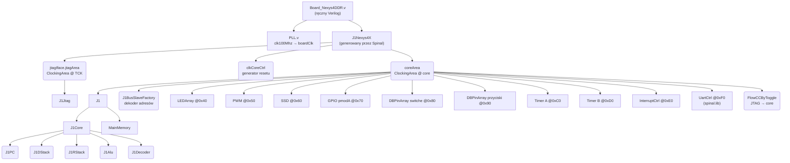
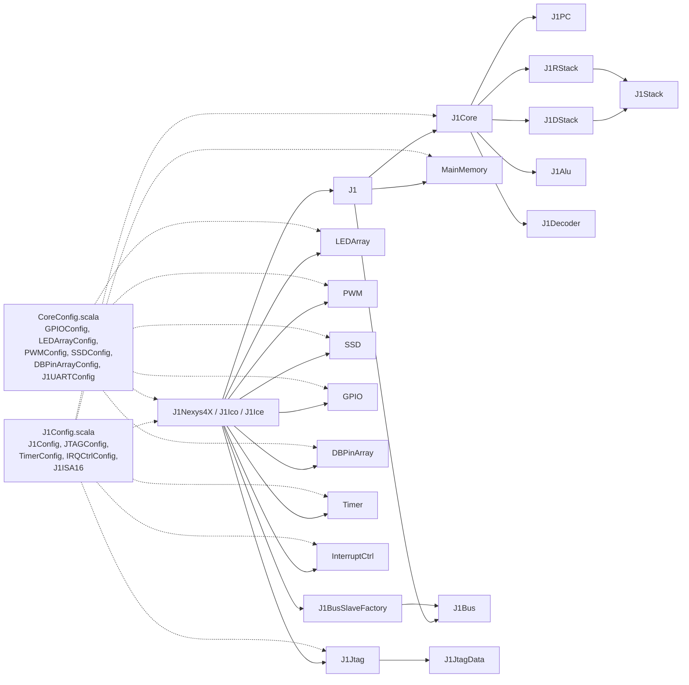
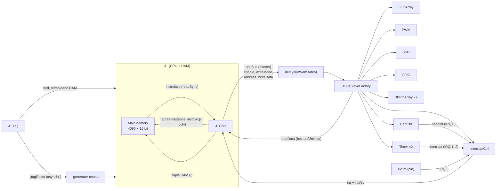
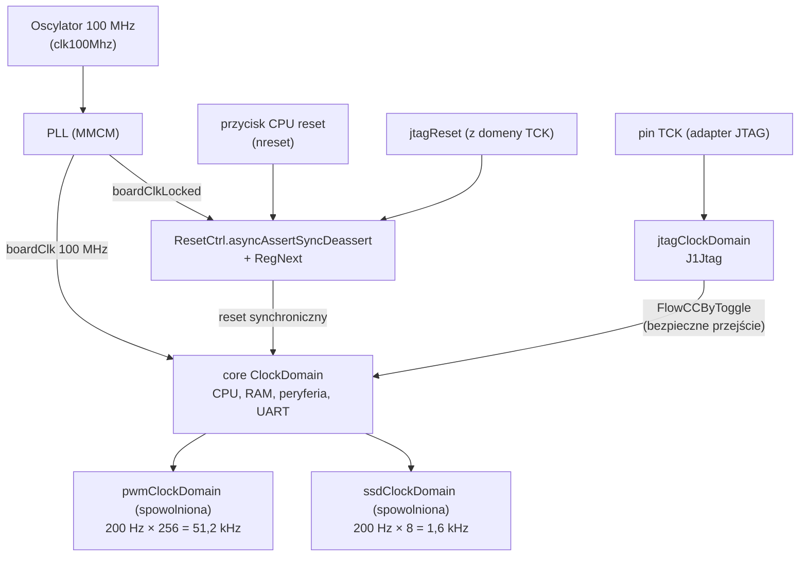
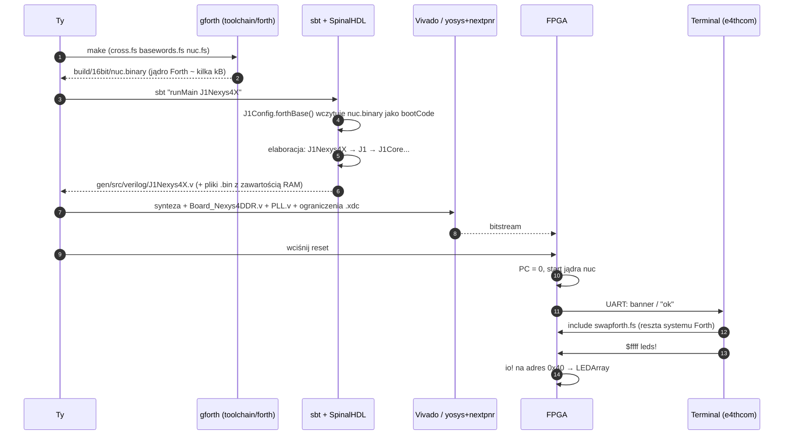

# 01 · Architektura: widok z lotu ptaka

[← spis treści](README.md)

## 1. Hierarchia sprzętu (co zawiera co)

Na przykładzie płytki **Nexys4DDR**, czyli najpełniejszego wariantu. Prostokąty to `Component` (osobne moduły w
wygenerowanym HDL). Zaokrąglone węzły to obiekty Scali lub `Area`, które **nie** tworzą osobnego modułu, tylko
"wklejają" logikę do rodzica.

**Jak to czytać:**

* `Board_Nexys4DDR.v` to jedyny plik HDL pisany ręcznie dla tej płytki. Robi trzy rzeczy: odwraca reset
  (`reset = !nreset`), instancjonuje PLL i zamienia trzy sygnały GPIO (`read`/`write`/`writeEnable`) na prawdziwy pin
  trójstanowy (`inout`). Wnętrza FPGA Spinal generuje sam.
* `J1Nexys4X` ([J1Nexys4X.scala](../src/main/scala/J1Nexys4X.scala)) to "płyta główna" SoC. Tworzy domeny zegarowe,
  CPU i peryferia, a potem łączy je magistralą i liniami przerwań.
* `J1` ([J1.scala](../src/main/scala/J1.scala)) to procesor razem z pamięcią: rdzeń + RAM + wyjście magistrali.
* `J1Core` ([J1Core.scala](../src/main/scala/J1Core.scala)) to sam procesor. Jego podzespoły (`J1PC`, `J1Alu`...) to
  zwykłe klasy Scali, które *wywołane* (`apply`) dobudowują logikę wewnątrz `J1Core`. Nie są osobnymi modułami.

## 2. Zależności między plikami Scali

Kto kogo tworzy (strzałka ciągła) i kto czyje konfiguracje czyta (przerywana).

Dwie konfiguracje mają rozdzielone role:

* **`J1Config`**: wszystko, co dotyczy *procesora*: szerokość słowa, głębokość stosów, wielkość RAM, obecność JTAG,
  liczba przerwań, zawartość pamięci przy starcie (`bootCode`).
* **`CoreConfig`**: wszystko, co dotyczy *płytki*: ile diod, jaki UART, jaka częstotliwość zegara, ile przycisków.

Dzięki temu ten sam CPU (`J1Config.forth16Jtag`) działa na trzech różnych płytkach.

## 3. Przepływ danych w działającym systemie

Najważniejsze obserwacje:

1. **Pamięć główna nie leży na magistrali peryferiów.** RAM jest wewnątrz `J1`. Instrukcje i dane idą bezpośrednio,
   a na magistralę `J1Bus` trafiają wyłącznie operacje `io@`/`io!`.
2. **Zapis do RAM** idzie osobnym portem zapisu. **Odczyt danych z RAM** używa portu *instrukcji* (sztuczka "high
   call", opisana w [04](04-pamiec-i-magistrala.md#5-odczyt-z-ram-sztuczka-high-call)).
3. **Każde peryferium** ma metodę `driveFrom(busCtrl, baseAddress)`, która rejestruje jego rejestry w fabryce
   `J1BusSlaveFactory`. Fabryka generuje z tego jeden duży dekoder adresów.
4. **Przerwania** wchodzą do CPU jako dwa sygnały: impuls `irq` i adres `intVec`. CPU nie ma osobnego mechanizmu
   ISR, po prostu "udaje", że z pamięci przyszła instrukcja `call intVec`.

## 4. Domeny zegarowe

* **core**: główna domena. Na Nexys4DDR 100 MHz, na IcoBoard 40 MHz, na iCEBreaker 18 MHz (`CoreConfig.coreFrequency`).
* **jtag**: taktowana pinem `TCK` z zewnętrznego adaptera, całkowicie asynchroniczna względem core. Dane przechodzą
  przez `FlowCCByToggle` (bezpieczne przekroczenie domen), a reset JTAG idzie przez synchronizator resetu.
* **Domeny spowolnione** (`newSlowedClockDomain`) w PWM i SSD. Spinal realizuje je jako tę samą linię zegarową z
  sygnałem *clock enable*, który generuje licznik dzielnika. Nie powstaje nowy zegar fizyczny.

Szczegóły resetu i zegarów znajdziesz w [08](08-konfiguracja-plyty-build.md#3-zegar-i-reset).

## 5. Droga od kodu do działającego Fortha

## 6. Kluczowe parametry domyślnego systemu (`forth16Jtag` + `nexys4DDR`)

| Parametr | Wartość | Skąd |
|----------|---------|------|
| Szerokość słowa | 16 bit | `J1Config.forth16Jtag.wordSize` |
| Pamięć główna | 2¹² = 4096 słów = 8 KB, 2 banki po 2048 | `adrWidth = 12`, `numOfRAMs = 2` |
| PC | 13 bitów (12 adresu + 1 bit "high call") | `J1PC` |
| Stos danych | 2⁵ = 32 komórki (+ rejestr T) | `dataStackIdxWidth = 5` |
| Stos powrotów | 2⁵ = 32 komórki | `returnStackIdxWidth = 5` |
| Przerwania | 4 (3 wewnętrzne + 1 zewnętrzne) | `noOfInterrupts = 4`, `noOfInternalInterrupts = 3` |
| Zegar | 100 MHz | `CoreConfig.nexys4DDR` |
| UART | 115200 bodów, 8N1, FIFO 8 | `J1UARTConfig.slowUartConfig` |
| JTAG | IR 5 bitów, IDCODE 0x01234567 | `JTAGConfig.default` |
