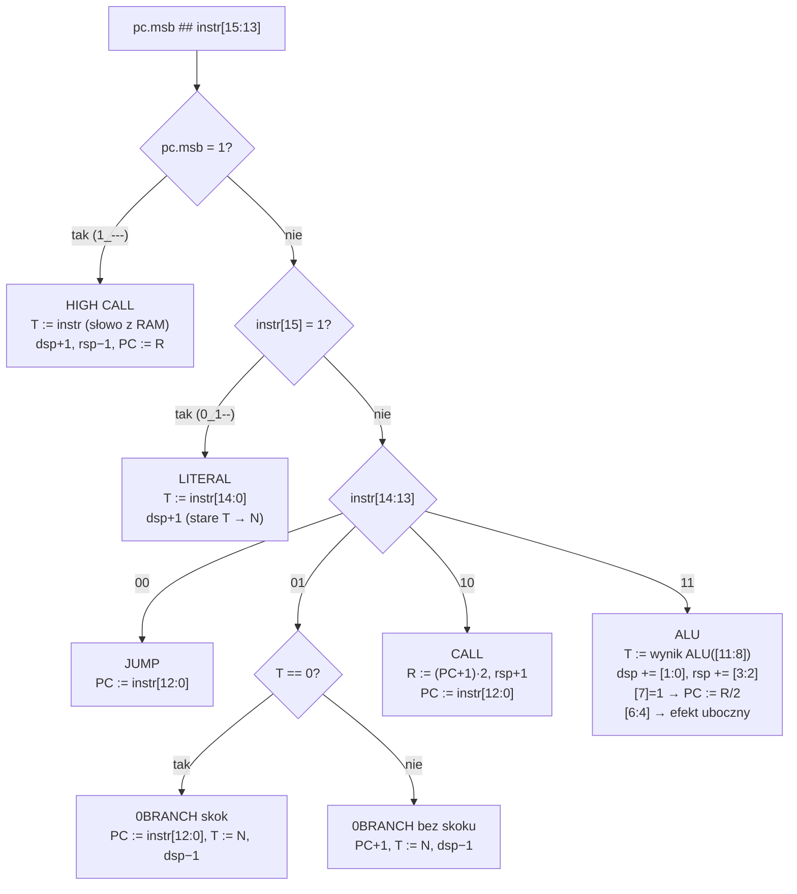

# 02 · Lista rozkazów J1 (ISA)

[← spis treści](README.md) · źródła: [J1Config.scala](../src/main/scala/J1Config.scala) (`J1ISA16`), [basewords.fs](../toolchain/forth/basewords.fs), [J1Core.scala](../src/main/scala/J1Core.scala), [J1Alu.scala](../src/main/scala/J1Alu.scala)

## 1. Model programisty

J1 to **maszyna stosowa**. Nie ma rejestrów ogólnego przeznaczenia, a wszystkie operacje działają na wierzchołku stosu.

| Element | Nazwa w kodzie | Opis |
|---------|----------------|------|
| **T** (top) | `dtos` | wierzchołek stosu danych, osobny rejestr |
| **N** (next) | `dnos` | drugi element stosu danych, czytany z pamięci stosu |
| **R** | `rtos` | wierzchołek stosu powrotów |
| **PC** | `pc` | licznik programu (adres *słowa*, nie bajtu) |
| dsp / rsp | `stackPtr` | wskaźniki stosów (niewidoczne, ale `depth` odczytuje dsp) |

Wszystkie instrukcje mają 16 bitów i wykonują się w **jednym takcie**. Wyjątki są pozorne: `io@`, `io!` i `!`
to po dwie instrukcje (patrz [04](04-pamiec-i-magistrala.md)).

## 2. Pięć formatów instrukcji

O typie decydują trzy najstarsze bity `instr[15:13]` (a dokładniej `pc.msb ## instr[15:13]`, patrz punkt 5).

| `[15:13]` | Typ | Pozostałe bity | Działanie |
|-----------|-----|----------------|-----------|
| `1xx` | **literal** | `[14:0]` = wartość | push wartości 15-bitowej (zero-extend) |
| `000` | **jump** | `[12:0]` = adres | `PC := adres` |
| `001` | **0branch** | `[12:0]` = adres | jeśli `T == 0`, to `PC := adres`; zawsze pop T |
| `010` | **call** | `[12:0]` = adres | push (PC+1) na R, `PC := adres` |
| `011` | **ALU** | pola poniżej | operacja na T/N/R + efekty uboczne |

```
literal  : 1 vvv vvvv vvvv vvvv      v = wartość (15 bit)
jump     : 0 0 0 a aaaa aaaa aaaa    a = adres słowa (13 bit, MSB = flaga "high")
0branch  : 0 0 1 a aaaa aaaa aaaa
call     : 0 1 0 a aaaa aaaa aaaa
ALU      : 0 1 1 - oooo r fff rr dd
                   │    │ │   │  └─ [1:0]  zmiana dsp (signed 2 bit)
                   │    │ │   └──── [3:2]  zmiana rsp (signed 2 bit)
                   │    │ └──────── [6:4]  funkcja dodatkowa
                   │    └────────── [7]    R → PC (return)
                   └─────────────── [11:8] kod operacji ALU (wynik → nowe T)
                 bit [12] nieużywany
```

> **Uwaga:** w oryginalnym J1 bit `R→PC` leży na pozycji 12. W J1Sc (wariant J1b-podobny ze SwapForth) jest to
> bit **7** (`instr(7)` w [J1PC.scala:41](../src/main/scala/J1PC.scala#L41)), a funkcje dodatkowe zajmują 3 bity `[6:4]`.

## 3. Pole operacji ALU `[11:8]`

Zaimplementowane jako jeden `mux` w [J1Alu.scala:24-51](../src/main/scala/J1Alu.scala#L24-L51).

| Kod | Słowo w `basewords.fs` | Wynik (nowe T) |
|-----|------------------------|----------------|
| `0000` | `T` | T |
| `0001` | `N` | N |
| `0010` | `T+N` | T + N |
| `0011` | `T&N` | T and N |
| `0100` | `T\|N` | T or N |
| `0101` | `T^N` | T xor N |
| `0110` | `~T` | not T |
| `0111` | `N==T` | -1 jeśli N == T, inaczej 0 |
| `1000` | `N<T` | -1 jeśli N < T (ze znakiem) |
| `1001` | `T2/` | T >> 1 arytmetycznie (powiela bit znaku) |
| `1010` | `T2*` | T << 1 |
| `1011` | `rT` | R (kopia wierzchołka stosu powrotów) |
| `1100` | `N-T` | N − T |
| `1101` | `io[T]` | dane odczytane z magistrali I/O |
| `1110` | `status` | wskaźnik stosu danych (`depth`) |
| `1111` | `Nu<T` | -1 jeśli N < T (bez znaku) |

Porównania zwracają "flagę Forth": `B(16 bits, default -> warunek)`, czyli same jedynki (`-1`) albo same zera.

## 4. Pola efektów ubocznych

### Funkcja `[6:4]` (dekodowana w [J1Core.scala:84-88](../src/main/scala/J1Core.scala#L84-L88))

| `[6:4]` | Słowo | Sygnał w `J1Core` | Efekt |
|---------|-------|-------------------|-------|
| `000` | — | — | brak |
| `001` | `T->N` | `funcTtoN` | stare T zapisane do pamięci stosu (staje się N) |
| `010` | `T->R` | `funcTtoR` | T zapisane na stos powrotów |
| `011` | `N->[T]` | `funcWriteMem` | zapis N do RAM pod adres T |
| `100` | `N->io[T]` | `funcWriteIO` | zapis N na magistralę I/O pod adres T |
| `101` | `_IORD_` | `funcReadIO` | odczyt z magistrali I/O |
| `110`, `111` | — | — | **wolne**, można dodać własne |

### Zmiany wskaźników stosu `[3:2]` (rsp) i `[1:0]` (dsp)

2-bitowa liczba ze znakiem: `00` = 0, `01` = +1, `10` = −2, `11` = −1.
W `basewords.fs`: `d+1` = `0x0001`, `d-1` = `0x0003`, `r+1` = `0x0004`, `r-1` = `0x000c`, `r-2` = `0x0008`.

## 5. Dekodowanie: drzewo decyzji

Dekoder ([J1Decoder.scala](../src/main/scala/J1Decoder.scala)) i logika stosów patrzą na **4 bity**:
`pc.msb ## instr[15:13]`. Dodatkowy bit `pc.msb` włącza tryb **"high call"**, czyli odczyt danych z RAM
(opis w [04](04-pamiec-i-magistrala.md#5-odczyt-z-ram-sztuczka-high-call)).



## 6. Słowa Forth = instrukcje maszynowe

Z [basewords.fs](../toolchain/forth/basewords.fs). Kodowanie: `alu` = `0x6000`, pozostałe pola są OR-owane.

| Słowo Forth | Złożenie w `basewords.fs` | Kod hex | Co się dzieje |
|-------------|---------------------------|---------|---------------|
| `noop` | `T alu` | `6000` | nic (to też instrukcja "NOP" wstrzykiwana przy stall) |
| `dup` | `T T->N d+1 alu` | `6011` | T bez zmian, stare T → N, dsp+1 |
| `drop` | `N d-1 alu` | `6103` | T := N, dsp−1 |
| `swap` | `N T->N alu` | `6110` | T := N, stare T → N |
| `over` | `N T->N d+1 alu` | `6111` | T := N, stare T → N, dsp+1 |
| `nip` | `T d-1 alu` | `6003` | T bez zmian, dsp−1 (N znika) |
| `+` | `T+N d-1 alu` | `6203` | T := T+N, dsp−1 |
| `-` | `N-T d-1 alu` | `6C03` | T := N−T, dsp−1 |
| `=` | `N==T d-1 alu` | `6703` | |
| `invert` | `~T alu` | `6600` | |
| `>r` | `N T->R r+1 d-1 alu` | `6127` | T → R, T := N |
| `r>` | `rT T->N r-1 d+1 alu` | `6B1D` | T := R, stare T → N |
| `r@` | `rT T->N d+1 alu` | `6B11` | |
| `exit` | `T RET r-1 alu` | `608C` | PC := R, rsp−1 (to `instrRTS` z `J1ISA16`) |
| `depth` | `status T->N d+1 alu` | `6E11` | T := dsp |
| `io@` | 2× `io[T] _IORD_ alu` | `6D50 6D50` | odczyt I/O, dwie instrukcje (wait state) |
| `io!` | `T N->io[T] d-1 alu` + `N d-1 alu` | `6043 6103` | zapis I/O, potem drop |
| `!` | `T N->[T] d-1 alu` + `N d-1 alu` | `6033 6103` | zapis RAM, potem drop |

Literał większy niż 15 bitów (np. `$8000`) kompilator Forth składa z dwóch instrukcji (literał + `invert`).

## 7. Przykład: `isaTest` zdekodowany

Pierwsze instrukcje programu testowego z [J1Config.scala:96](../src/main/scala/J1Config.scala#L96):

| Adr | Binarnie | Typ | Znaczenie |
|-----|----------|-----|-----------|
| 0 | `1000_0000_0000_0111` | literal | push 7 |
| 1 | `1000_0000_0000_0011` | literal | push 3 |
| 2 | `0000_0000_0000_0100` | jump | skok do 4 |
| 3 | `1000_0000_0000_0001` | literal | push 1 (pominięte) |
| 4 | `1000_0000_0000_1111` | literal | push 15 |
| 5 | `0110_0010_0000_0011` | ALU | op `0010` (T+N), dsp −1 → `+` |
| 6 | `0110_0010_0000_0001` | ALU | T+N, dsp +1, bez T→N (patrz uwaga niżej) |
| 7 | `0110_0010_0000_0000` | ALU | T+N, stos bez zmian |
| 8 | `0010_0000_0000_1011` | 0branch | jeśli T==0 skocz do 11 |
| 11 | `0100_0000_0010_0000` | call | wywołaj 32 |
| 49 | `0110_0000_1000_1100` | ALU | `exit` (return) |

> **Uwaga o „ISA bug”** ([J1DStack.scala:54](../src/main/scala/J1DStack.scala#L54)): w instrukcji ALU zapis do pamięci
> stosu (`stackWriteEnable`) następuje **tylko** przy `T->N`. Instrukcja z `d+1`, ale bez `T->N` (jak adres 6),
> przesuwa wskaźnik, lecz nie zapisuje starego T. Nowe N to wtedy śmieć z pamięci stosu. Autor zostawił w komentarzu
> poprawkę (`| instr(1 downto 0) === B"b01"`). SwapForth nigdy nie generuje takiej kombinacji.
