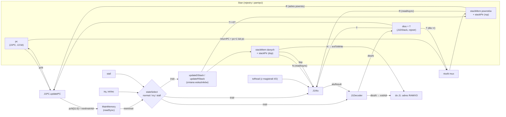
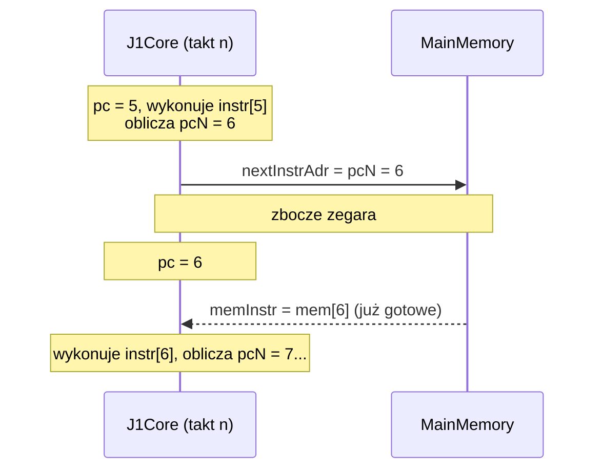
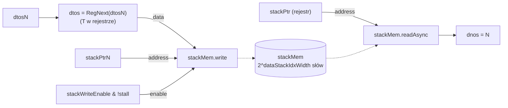
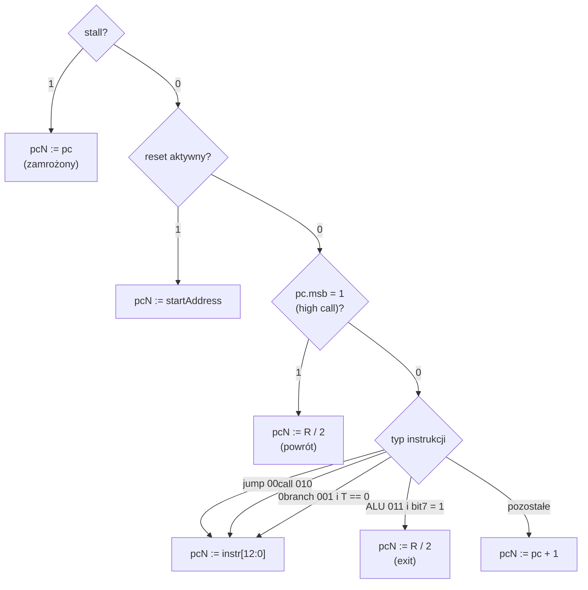
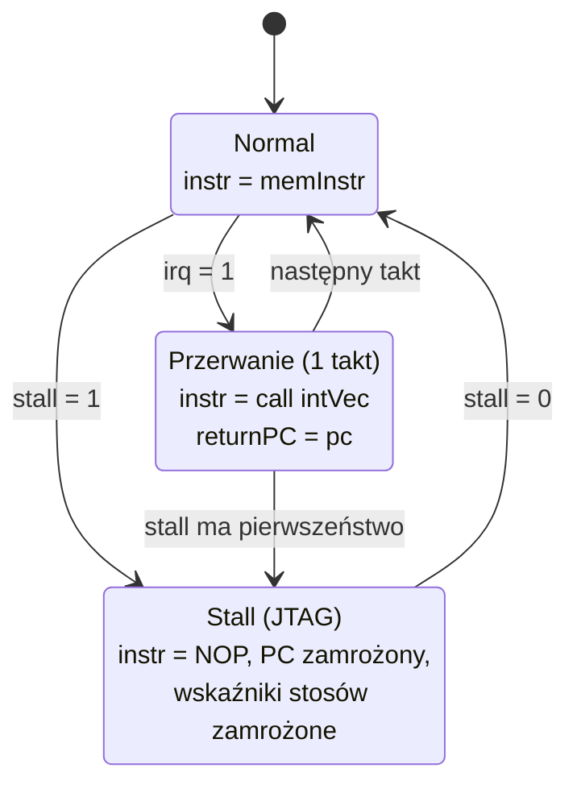

# 03 · Rdzeń CPU (`J1Core` i podzespoły)

[← spis treści](README.md) · źródła: [J1Core.scala](../src/main/scala/J1Core.scala), [J1PC.scala](../src/main/scala/J1PC.scala), [J1Stack.scala](../src/main/scala/J1Stack.scala), [J1DStack.scala](../src/main/scala/J1DStack.scala), [J1RStack.scala](../src/main/scala/J1RStack.scala), [J1Alu.scala](../src/main/scala/J1Alu.scala), [J1Decoder.scala](../src/main/scala/J1Decoder.scala)

## 1. Ścieżka danych: jeden takt = jedna instrukcja

J1 nie ma potoku (pipeline). Każdy takt to: rejestry → logika kombinacyjna → nowe wartości rejestrów.
Cała praca dzieje się "w przewodach" między rejestrami.



### Kluczowa sztuczka: pobieranie instrukcji bez opóźnienia

Pamięć główna jest **synchroniczna** (`readSync`): adres podany w takcie *n* daje dane w takcie *n+1*. Gdyby adresować
ją przez `pc`, każda instrukcja czekałaby takt. Dlatego rdzeń wystawia adres **następnej** instrukcji
(`nextInstrAdr := pcN`, [J1Core.scala:112](../src/main/scala/J1Core.scala#L112)). W chwili, gdy `pc` przyjmuje
wartość `pcN`, instrukcja spod tego adresu jest już na wyjściu pamięci.



## 2. Wzorzec "sygnał N": deklaruj, użyj, dopiero potem steruj

W kodzie rdzenia ciągle widać pary `x` / `xN` (`pc`/`pcN`, `dtos`/`dtosN`, `stackPtr`/`stackPtrN`). `xN` to
**kombinacyjna wartość, jaką rejestr przyjmie w następnym takcie**.

Problem polega na tym, że zależności tworzą pętlę: `dtosN` zależy od wyniku ALU, wynik ALU od `dtos`,
a `dtos = RegNext(dtosN)`. W sprzęcie to normalne, bo pętlę przecina rejestr. W Scali zmienna musi jednak
istnieć, zanim się jej użyje. Rozwiązanie w [J1Core.scala](../src/main/scala/J1Core.scala):

```scala
val dtosN      = Bits(cfg.wordSize bits)          // 1. deklaracja "pustego przewodu"
val dStackInfo = dStack(internal.stall, dtosN)    // 2. użycie: dtos = RegNext(dtosN)
...
dtosN := J1Decoder(cfg)(pc, instr, dtos, dnos, aluResult)   // 3. sterowanie, dużo później
```

To samo robią stosy: `apply(...)` tworzy pamięć i porty odczytu, a osobna metoda `updateDStack(...)` /
`updateRStack(...)` wywołana później steruje `stackPtrN` i `stackWriteEnable`. **Kolejność instrukcji `:=` w Spinalu
nie oznacza kolejności w czasie.** Opisujesz po prostu połączenia.

Zwróć uwagę, że `J1PC`, `J1Alu`, `J1Decoder` to zwykłe `case class`, a nie `Component`, a `J1Stack` dziedziczy po
`Area`. Ich logika trafia więc **do wnętrza modułu `J1Core`** w wygenerowanym Verilogu, bez osobnych modułów i portów.

## 3. Podzespoły plik po pliku

### 3.1 `J1Stack`: wspólna baza stosów

[J1Stack.scala](../src/main/scala/J1Stack.scala). `Area` z trzema elementami:

* `stackPtr`: rejestr wskaźnika (init 0),
* `stackPtrN`: wartość wskaźnika w następnym takcie,
* `stackWriteEnable`: czy w tym takcie zapisać do pamięci stosu.

### 3.2 `J1DStack`: stos danych

[J1DStack.scala](../src/main/scala/J1DStack.scala)



* **T trzymany jest w osobnym rejestrze** (`dtos`), a reszta stosu w pamięci. N to komórka pod `stackPtr`.
* **Push** (`stackPtrInc = +1`, `stackWriteEnable = 1`): stare T zapisuje się pod *nowy* wskaźnik (`stackPtrN`), czyli
  staje się N. Równocześnie do rejestru T wpada nowa wartość.
* **Pop** (`stackPtrInc = −1`): wskaźnik się cofa, więc N jest teraz o komórkę niżej. Do T zwykle trafia stare N
  (dekoder wybiera `dnos`).
* `readUnderWrite = writeFirst` sprawia, że jeśli w tym samym takcie zapisujemy i czytamy tę samą komórkę, odczyt
  zobaczy nową wartość.

`updateDStack` ([J1DStack.scala:40](../src/main/scala/J1DStack.scala#L40)), czyli decyzja o wskaźniku:

| `pc.msb ## instr[15:13]` | Przypadek | write | Δdsp |
|--------------------------|-----------|:-----:|:----:|
| `1_---` | high call (odczyt RAM) | 1 | +1 |
| `0_1--` | literal | 1 | +1 |
| `0_001` | 0branch | 0 | −1 |
| `0_011` | ALU | `T->N` | `instr[1:0]` |
| inne | jump / call | 0 | 0 |

### 3.3 `J1RStack`: stos powrotów

[J1RStack.scala](../src/main/scala/J1RStack.scala). Inaczej niż stos danych, **wierzchołek R też jest w pamięci**
(`rtos = readAsync(stackPtr)`), bez osobnego rejestru.

| `pc.msb ## instr[15:13]` | Przypadek | write | Δrsp |
|--------------------------|-----------|:-----:|:----:|
| `1_---` | high call: powrót po odczycie RAM | 0 | −1 |
| `0_010` | call (także wstrzyknięty przez przerwanie) | 1 | +1 |
| `0_011` | ALU | `T->R` | `instr[3:2]` |
| inne | | 0 | 0 |

Co jest zapisywane (`rtosN`, [J1Core.scala:70](../src/main/scala/J1Core.scala#L70)):

```scala
val rtosN = Mux(!instr(13), (returnPC ## B"b0").resized, dtos)
```

* bit 13 = 0 → to **call** (`010`), więc zapisujemy adres powrotu **przesunięty o 1 w lewo** (adres bajtowy!),
* bit 13 = 1 → to **ALU** z `T->R` (`>r`), więc zapisujemy T.

> Adresy powrotu są na stosie R trzymane jako **adresy bajtowe** (×2), bo Forth operuje na bajtach. Przy powrocie
> `J1PC` bierze `rtos(adrWidth+1 downto 1)`, czyli dzieli przez 2. Dzięki temu `r>` daje programowi
> "normalny" adres bajtowy, a `>r` + `exit` działa jak skok pośredni (to wykorzystuje słowo `execute`).

### 3.4 `J1PC`: licznik programu

[J1PC.scala](../src/main/scala/J1PC.scala)

* `pc` ma **`adrWidth + 1` bitów**. Dodatkowy MSB to flaga "high call" (patrz [04 §5](04-pamiec-i-magistrala.md#5-odczyt-z-ram-sztuczka-high-call)).
* `apply(pcN, clrActive, irq)` tworzy rejestr i zwraca `(pc, returnPC)`, gdzie
  `returnPC = irq ? pc : pc + 1`. Przy przerwaniu bieżąca instrukcja *nie została* wykonana (zastąpił ją
  wstrzyknięty `call`), więc po powrocie trzeba ją wykonać.
* `updatePC(...)` liczy `pcN`. Switch po wektorze `stall ## clrActive ## pc.msb ## instr[15:13] ## instr[7] ## T≠0`:



Jest tu subtelność: cel skoku `instr(adrWidth downto 0)` ma 13 bitów, łącznie z bitem "high". Skok/call pod adres z
ustawionym MSB włączyłby tryb high call. W praktyce robi się to wyłącznie przez `exit` (patrz słowo `@`).

### 3.5 `J1Alu`: jednostka arytmetyczno-logiczna

[J1Alu.scala](../src/main/scala/J1Alu.scala). Wynik to **jeden multiplekser** (`getALUOp(instr).mux(...)`) po
4 bitach `[11:8]`. Tabela kodów jest w [02 §3](02-isa.md#3-pole-operacji-alu-118). Co warto zauważyć:

* `difference = N − T` liczone na 17 bitach. Jest **współdzielone** przez odejmowanie, `N==T` (difference = 0),
  `Nu<T` (bit pożyczki = MSB 17-bitowego wyniku) i `N<T`.
* `N<T` ze znakiem: `nosIsLess = (T.msb ^ N.msb) ? N.msb : difference.msb`. Jeśli znaki są różne, mniejsza jest
  liczba ujemna. Jeśli takie same, decyduje znak różnicy.
* Operacja `1101` (`io[T]`) zwraca `toRead`, czyli dane z magistrali I/O (albo 0, gdy nie ma odczytu).
* Operacja `1110` zwraca `dStackPtr` (`depth` w Forth).

### 3.6 `J1Decoder`: co będzie nowym T

[J1Decoder.scala](../src/main/scala/J1Decoder.scala). Mimo nazwy nie dekoduje wszystkiego, tylko wybiera `dtosN`:

| Przypadek | `dtosN` |
|-----------|---------|
| high call | `instr` (to, co przyszło z RAM, czyli odczytane słowo danych) |
| literal | `instr[14:0]` |
| jump, call | `dtos` (bez zmian) |
| 0branch | `dnos` (pop) |
| ALU | `aluResult` |
| (default) | same jedynki (nieosiągalne) |

### 3.7 `J1Core`: sklejenie

[J1Core.scala](../src/main/scala/J1Core.scala), linia po linii:

| Linie | Co się dzieje |
|-------|---------------|
| [14-15](../src/main/scala/J1Core.scala#L14-L15) | asercje: tylko 16 bit przetestowane, adres musi się zmieścić w instrukcji |
| [18-39](../src/main/scala/J1Core.scala#L18-L39) | porty: interfejs RAM/I/O, stall, irq/intVec, port instrukcji |
| [45](../src/main/scala/J1Core.scala#L45) | `clrActive = ClockDomain.current.isResetActive`: reset widziany jako sygnał logiczny |
| [48-52](../src/main/scala/J1Core.scala#L48-L52) | utworzenie PC |
| [55-59](../src/main/scala/J1Core.scala#L55-L59) | **multiplekser instrukcji**: normal → z RAM; irq → `010 ## intVec` (call); stall → NOP |
| [62-67](../src/main/scala/J1Core.scala#L62-L67) | stos danych |
| [70-74](../src/main/scala/J1Core.scala#L70-L74) | `rtosN` + stos powrotów |
| [77-81](../src/main/scala/J1Core.scala#L77-L81) | ALU + dekoder → `dtosN` |
| [84-89](../src/main/scala/J1Core.scala#L84-L89) | dekodowanie pól `[6:4]` i flaga `isALU` |
| [92-96](../src/main/scala/J1Core.scala#L92-L96) | sygnały na zewnątrz: zapis RAM, zapis/odczyt I/O, adres = `dtosN`, dane = `dnos`. Wszystko zablokowane podczas resetu |
| [99-102](../src/main/scala/J1Core.scala#L99-L102) | sterowanie wskaźnikami stosów |
| [105-112](../src/main/scala/J1Core.scala#L105-L112) | logika PC i adres następnej instrukcji |

**Trzy tryby pracy** (multiplekser `stateSelect`):



## 4. Śledzenie wykonania cykl po cyklu

Program `isaTest` ([J1Config.scala:96](../src/main/scala/J1Config.scala#L96)). Wartości **po** takcie.
`mem[k]` to komórka pamięci stosu danych.

| Takt | pc | Instrukcja | Co się dzieje | T | dsp | N = mem[dsp] |
|-----:|---:|------------|---------------|--:|----:|-------------:|
| 0 | 0 | (reset) | | 0 | 0 | ? |
| 1 | 0 | `push 7` | mem[1] ← T(0), T ← 7 | 7 | 1 | 0 |
| 2 | 1 | `push 3` | mem[2] ← 7, T ← 3 | 3 | 2 | 7 |
| 3 | 2 | `jump 4` | pcN = 4 | 3 | 2 | 7 |
| 4 | 4 | `push 15` | mem[3] ← 3, T ← 15 | 15 | 3 | 3 |
| 5 | 5 | `+` (T+N, d−1) | T ← 15+3 | 18 | 2 | 7 |

<details>
<summary>Odpowiedź do ćwiczenia: takty 6–8 (rozwiń dopiero po samodzielnej próbie)</summary>

| Takt | pc | Instrukcja | Co się dzieje | T | dsp | N |
|-----:|---:|------------|---------------|--:|----:|--:|
| 6 | 6 | T+N, d+1, **bez** T→N | T ← 18+7; dsp rośnie, ale nic nie zapisano; N to stara zawartość mem[3] | 25 | 3 | 3 |
| 7 | 7 | T+N, stos bez zmian | T ← 25+3 | 28 | 3 | 3 |
| 8 | 8 | `0branch 11` | T ≠ 0, więc brak skoku; T ← N, dsp−1 | 3 | 2 | 7 |
| 9 | 9 | `push 0` | | 0 | 3 | 3 |
| 10 | 10 | `0branch 10` | T = 0, więc skok do 10; T ← N | 3 | 2 | 7 |
| 11 | 10 | `0branch 10` | T ≠ 0, idź dalej; T ← N | 7 | 1 | 0 |
| 12 | 11 | `call 32` | R ← 12·2 = 24, rsp+1, pcN = 32 | 7 | 1 | 0 |

Takt 6 pokazuje w praktyce "ISA bug" z [02 §7](02-isa.md#7-przykład-isatest-zdekodowany).
</details>

## 5. Pytania kontrolne

1. Dlaczego `internal.extAdr := dtosN`, a nie `dtos`? (podpowiedź: [04 §4](04-pamiec-i-magistrala.md#4-timing-operacji-na-magistrali))
2. Co się stanie, gdy stos danych przepełni się (33 pushe przy `dataStackIdxWidth = 5`)?
   (Wskaźnik się zawija, nie ma wykrywania przepełnienia.)
3. Dlaczego przy `stall` wystarczy wstrzyknąć NOP, a rejestr `dtos` (nieblokowany przez stall) się nie zepsuje?
   (NOP = `T alu`, więc `dtosN = dtos`.)
4. Gdzie fizycznie leży R: w rejestrze czy w pamięci? A T?
