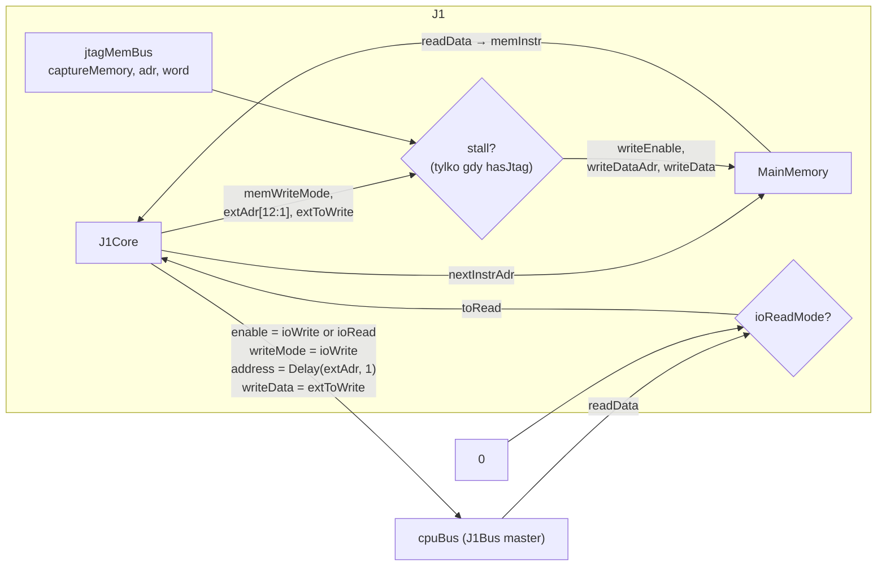
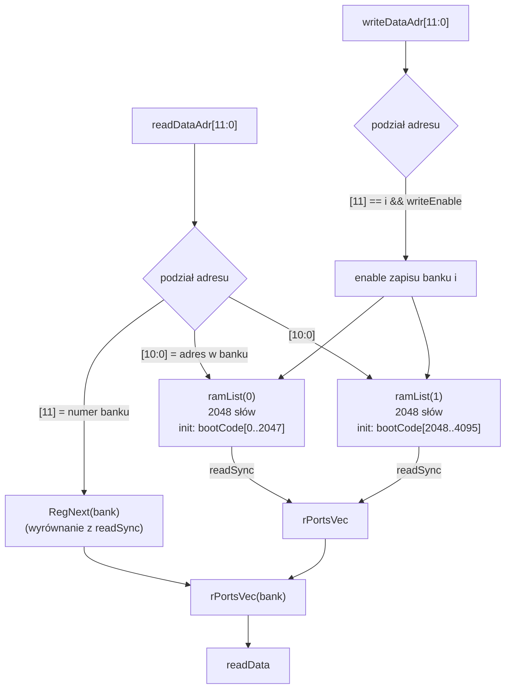
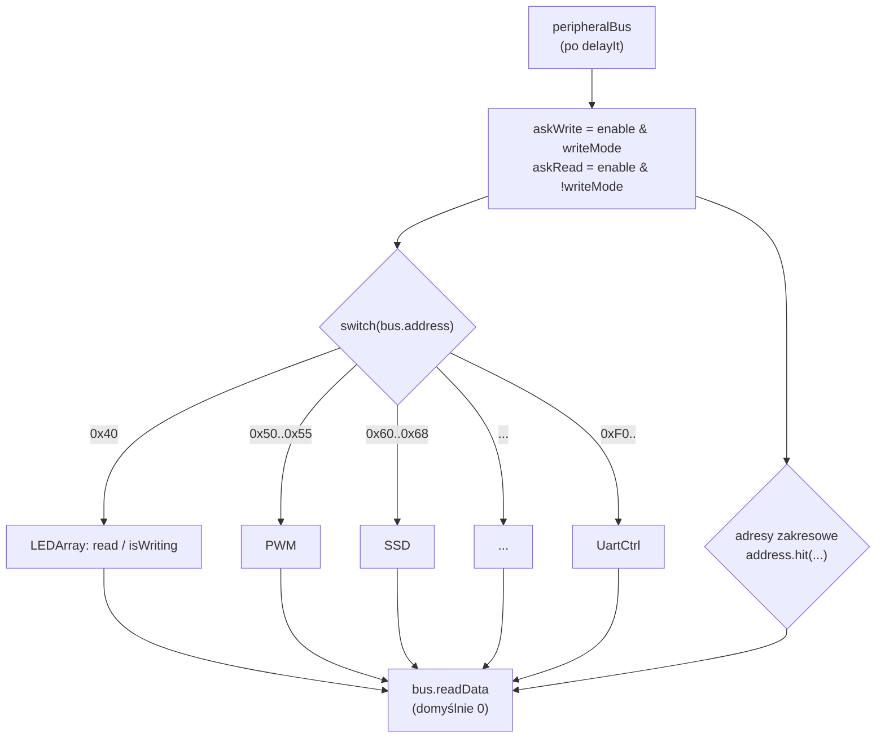
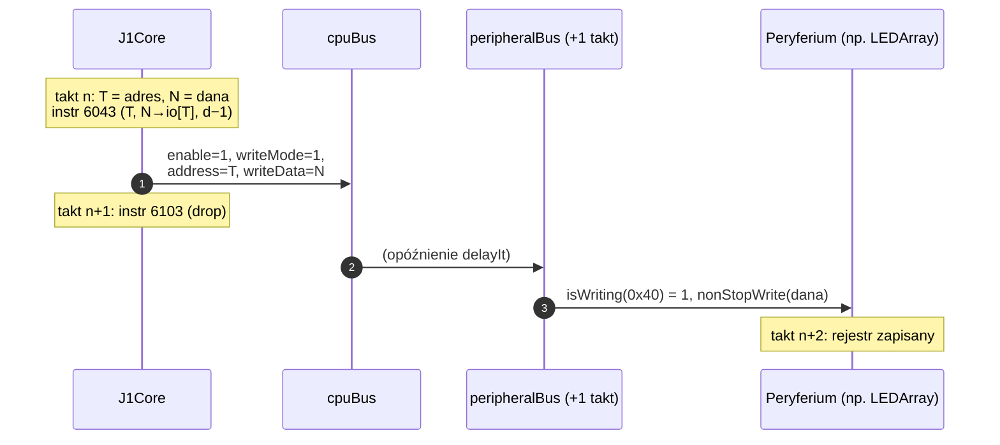
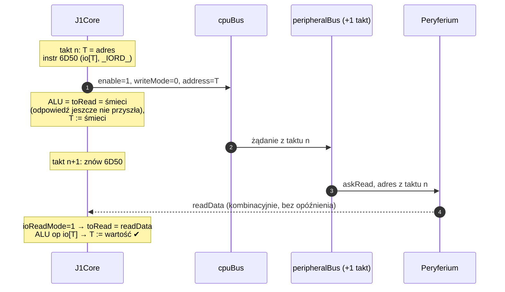
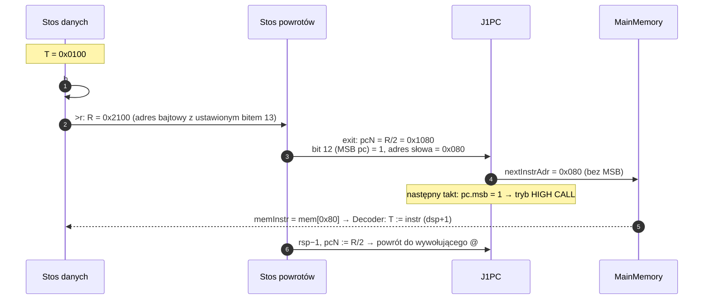

# 04 · Pamięć główna i magistrala peryferiów

[← spis treści](README.md) · źródła: [J1.scala](../src/main/scala/J1.scala), [MainMemory.scala](../src/main/scala/MainMemory.scala), [J1Bus.scala](../src/main/scala/J1Bus.scala), [J1BusSlaveFactory.scala](../src/main/scala/J1BusSlaveFactory.scala)

## 1. `J1`: procesor jako całość

[J1.scala](../src/main/scala/J1.scala) to `Component`, który łączy `J1Core` z `MainMemory` i wystawia na zewnątrz
**magistralę `cpuBus`** (master) oraz wejścia `stall`, `irq`, `intVec` i (opcjonalnie) port JTAG do pamięci.



* **Port instrukcji** (tylko odczyt): `nextInstrAdr` → `readDataAdr`, `readData` → `memInstr`.
* **Port zapisu**: normalnie steruje nim rdzeń. Gdy `hasJtag` i CPU jest zatrzymany (`stall`), przejmuje go JTAG.
  Tak wgrywa się program bez resyntezy (patrz [07](07-jtag-i-debug.md)).
* **Adres bajtowy → adres słowa**: `extAdr(cfg.adrWidth downto 1)` odrzuca bit 0. Forth adresuje bajty, RAM słowa.
* **Odczyt I/O**: `toRead = ioReadMode ? cpuBus.readData : 0`.
* **Adres na magistrali** to `Delay(extAdr, 1)`. Dlaczego, wyjaśnia §4.

## 2. `MainMemory`: RAM sklejony z banków

[MainMemory.scala](../src/main/scala/MainMemory.scala). Komentarz w nagłówku tłumaczy powód: Vivado 2016.4 nie umiał
poprawnie wygenerować dwuportowego BRAM > 64K, więc pamięć dzielona jest na `numOfRAMs` banków (potęga 2, min. 2).



* Każdy bank to `Mem(Bits(16 bits), initialContent)`. Spinal wypełnia go fragmentem `cfg.bootCode()`, więc
  **program jest "wypalony" w bitstreamie**. W Verilogu powstają pliki `*.v_toplevel_coreArea_cpu_mainMem_ramList_N.bin`
  ładowane przez `$readmemb` (stąd "ugly workaround" z kopiowaniem w `build.sbt`).
* Numer banku przy odczycie jest **zarejestrowany** (`RegNext`), bo dane z `readSync` przychodzą takt później.
  Multiplekser musi wybrać bank według adresu z *poprzedniego* taktu.
* Przy uruchomieniu generator wypisuje `[J1Sc] Create 2 RAMs which have 2048 cells each`.

## 3. `J1Bus` i `J1BusSlaveFactory`: magistrala peryferiów

### 3.1 Sygnały `J1Bus`

[J1Bus.scala](../src/main/scala/J1Bus.scala). Prosta magistrala synchroniczna (autorstwa Charlesa Papona, twórcy Spinala):

| Sygnał | Kierunek (z punktu widzenia mastera) | Znaczenie |
|--------|--------------------------------------|-----------|
| `enable` | out | transakcja w tym takcie |
| `writeMode` | out | 1 = zapis, 0 = odczyt |
| `address` | out | 16-bitowy adres I/O |
| `writeData` | out | dane do zapisu |
| `readData` | in | dane odczytane (kombinacyjnie, w tym samym takcie co `enable` widziany przez slave'a) |

Metody:
* `asMaster()`: ustala kierunki (`IMasterSlave`), więc `master(J1Bus(cfg))` w `J1` daje poprawne porty.
* `<<` / `>>`: połączenie dwóch magistrali.
* **`delayIt(ticks)`**: tworzy kopię, w której `address`, `enable`, `writeMode`, `writeData` są opóźnione o `ticks`
  taktów, a `readData` **nie jest** opóźniane. W ten sposób powstaje "wait state" dla peryferiów.

### 3.2 Fabryka slave'ów

[J1BusSlaveFactory.scala](../src/main/scala/J1BusSlaveFactory.scala) rozszerza `BusSlaveFactoryDelayed` ze
`spinal.lib`. To mechanizm, dzięki któremu peryferium pisze tylko:

```scala
busCtrl.read(io.leds, baseAddress + 0)          // rejestr do odczytu
busCtrl.nonStopWrite(bus.ledValue, 0)           // writeData zawsze podłączone do sygnału
bus.writeEnable := busCtrl.isWriting(baseAddress + 0)   // impuls przy zapisie pod adres
```

Fabryka **zbiera** te deklaracje od wszystkich peryferiów (`elementsPerAddress`), a w `build()` generuje jeden dekoder:



* `readHalt` / `writeHalt` rzucają wyjątek, bo peryferia nie mogą wstrzymać magistrali (brak sygnału `ready`).
* `bus.readData := 0` na początku zapobiega powstaniu zatrzasku (latch). Nieobsłużony adres czyta się jako 0.

## 4. Timing operacji na magistrali

Tu jest najwięcej subtelności. Trzeba pamiętać o trzech opóźnieniach:

1. `extAdr = dtosN`, czyli adres wyliczony **o takt za wcześnie** (wartość, którą T dopiero przyjmie).
2. `cpuBus.address = Delay(extAdr, 1)`. To kompensuje (1): w takcie wykonania instrukcji adres = bieżące T.
3. `peripheralBus = cpuBus.delayIt(ioWaitStates)` (domyślnie 1), czyli peryferium widzi żądanie **takt później**.

### 4.1 Zapis I/O: `io!` (`6043` + `6103`)



### 4.2 Odczyt I/O: `io@` (`6D50` dwa razy)

Dlaczego dwie identyczne instrukcje? Bo odpowiedź peryferium przychodzi takt po żądaniu:



Druga instrukcja też wystawia żądanie odczytu, tyle że pod adres równy "śmieciowemu" T z pierwszej instrukcji.
Zwykle to nieszkodliwe, bo odczyt zwykłego rejestru nic nie zmienia. Teoretycznie, gdyby śmieć trafił w rejestr z
efektem ubocznym odczytu (FIFO RX UART pod `0xF0`), zostałby on wyzwolony. Dobre pytanie do zbadania w symulacji,
patrz [10-obserwacje.md](10-obserwacje.md).

### 4.3 Zapis do RAM: `!` (`6033` + `6103`)

Instrukcja `T N->[T] d-1`: ALU daje `T` (adres), więc `dtosN = T`, `extAdr = adres`, a `memWriteMode = 1`.
Port zapisu RAM używa `extAdr` **bez** opóźnienia (bo `dtosN == dtos`), więc zapis dzieje się w tym samym takcie.

## 5. Odczyt z RAM: sztuczka high call

ALU **nie ma** operacji "czytaj RAM pod adresem T" (`io[T]` czyta tylko magistralę I/O). Jak więc działa `@`?
Odpowiedź jest w [nuc.fs](../toolchain/forth/nuc.fs):

```forth
: execute  >r  : noop ;          \ execute = >r, potem exit (z noop)
: @        h# 2000 or execute ;  \ adres bajtowy | 0x2000, potem "skocz tam"
```

Krok po kroku dla `adres = 0x0100` (bajt 256 = słowo 128):



Czyli: ustawienie najstarszego bitu PC zamienia **słowo pobrane jako instrukcja** w **daną** wpychaną na stos. Od
razu następuje też powrót, tak jakby wykonano `exit`. Dodatkowy bit PC kosztuje jeden przerzutnik, a oszczędza
drugi port odczytu RAM.

`c@` jest zbudowane na `@`: czyta słowo i przesuwa o 8 bitów, jeśli adres jest nieparzysty.

## 6. Podsumowanie: kto adresuje co

| Operacja | Instrukcje | Adres z | Port | Opóźnienie |
|----------|-----------|---------|------|------------|
| pobranie instrukcji | — | `pcN` | RAM odczyt (readSync) | 0 (dzięki `pcN`) |
| `@` (odczyt RAM) | `or` `>r` `exit` | R/2 z MSB | RAM odczyt (ten sam!) | 1 takt high call |
| `!` (zapis RAM) | `6033 6103` | `dtosN` (= T) | RAM zapis | 0 |
| `io!` | `6043 6103` | `Delay(dtosN)` → `delayIt` | J1Bus | +1 (wait state) |
| `io@` | `6D50 6D50` | jw. | J1Bus | wynik w drugiej instrukcji |
| JTAG zapis RAM | — | `jtagMemAdr` | RAM zapis (gdy stall) | — |
