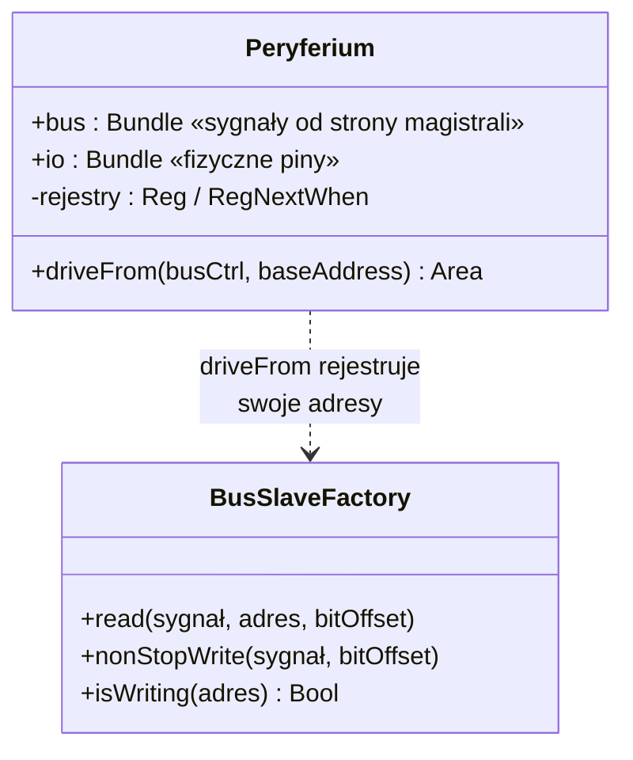
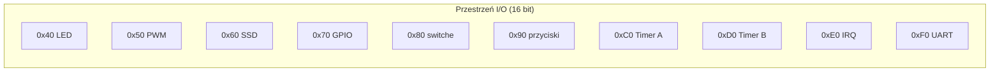
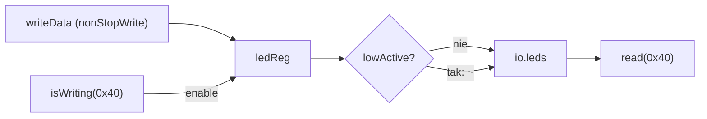
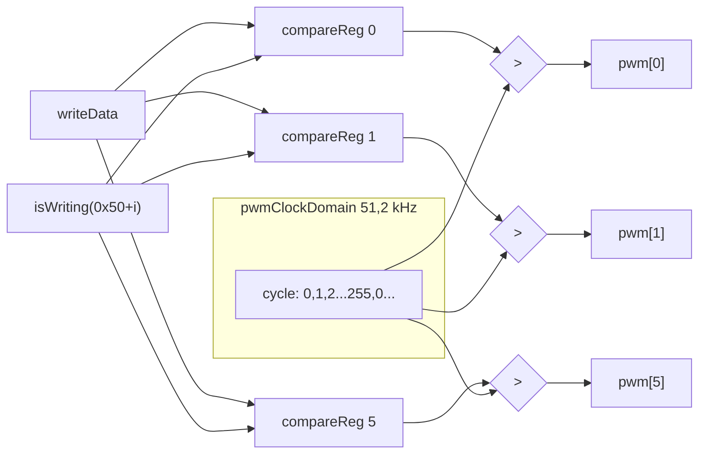
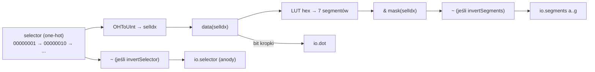
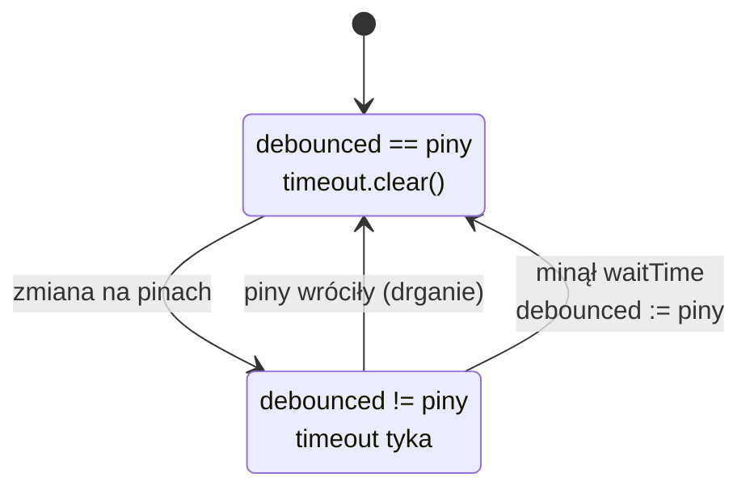
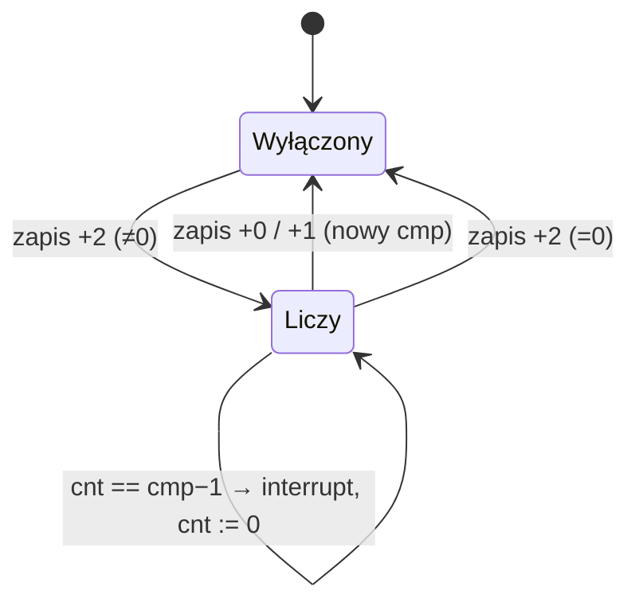

# 05 · Peryferia

[← spis treści](README.md) · źródła: [LEDArray.scala](../src/main/scala/LEDArray.scala), [PWM.scala](../src/main/scala/PWM.scala), [SSD.scala](../src/main/scala/SSD.scala), [GPIO.scala](../src/main/scala/GPIO.scala), [DBPinArray.scala](../src/main/scala/DBPinArray.scala), [Timer.scala](../src/main/scala/Timer.scala), [J1Nexys4X.scala](../src/main/scala/J1Nexys4X.scala), [peripheral.fs](../toolchain/forth/common/peripheral.fs)

## 1. Wspólny wzorzec każdego peryferium

Każde peryferium to `Component` o tej samej strukturze:



* **`bus`**: wejścia typu "nowa wartość" + "enable zapisu" oraz wyjścia "bieżąca wartość do odczytu".
* **`io`**: to, co wychodzi na piny płytki.
* **`driveFrom`**: jedyne miejsce, które zna adresy. Komponent sam nie wie, gdzie jest zmapowany.
  Top (`J1Nexys4X`) wywołuje `x.driveFrom(peripheralBusCtrl, baseAddress = 0x40)`.

Typowa trójka wywołań:

```scala
busCtrl.read(io.coś, baseAddress + k)          // odczyt pod adresem base+k
busCtrl.nonStopWrite(bus.nowaWartość, 0)       // writeData magistrali podpięte "na stałe"
bus.enable := busCtrl.isWriting(baseAddress+k) // impuls 1 takt przy zapisie pod base+k
```

`nonStopWrite` oznacza, że `bus.nowaWartość` *zawsze* równa się danym na magistrali. Rejestr wewnątrz komponentu łapie
ją tylko wtedy, gdy `enable` = 1 (`RegNextWhen`).

## 2. Mapa adresów I/O (Nexys4X)

Adresy to wartości T przy `io@` / `io!`. Słowa Forth pochodzą z [peripheral.fs](../toolchain/forth/common/peripheral.fs).

| Adres | Komponent | Rejestr | R/W | Słowo Forth |
|-------|-----------|---------|-----|-------------|
| `0x40` | LEDArray | stan 16 diod | R/W | `leds!` `leds@` |
| `0x50`–`0x55` | PWM | wypełnienie kanałów 0..5 (8 bit) | R/W | `rgbled!` `rgbled@` |
| `0x60`–`0x67` | SSD | cyfra wyświetlacza 0..7 (bit 15 = kropka, bity 3..0 = cyfra hex) | R/W | `ssd!` `ssd@` |
| `0x68` | SSD | maska aktywnych wyświetlaczy | R/W | `ssdMask!` `ssdMask@` |
| `0x70` | GPIO pmodA | kierunek (1 = wyjście) | R/W | `pmodADir!` |
| `0x74` | GPIO pmodA | dane | R/W | `pmodA!` `pmodA@` |
| `0x80` | DBPinArray | 16 przełączników (debounced) | R | `sSw@` |
| `0x90` | DBPinArray | 5 przycisków (debounced) | R | `pBtn@` |
| `0xC0` / `0xC1` / `0xC2` | Timer A | porównanie low / high / enable | R/W | `ltA!` `htA!` `entA` `distA` |
| `0xD0` / `0xD1` / `0xD2` | Timer B | jw. | R/W | (brak gotowych słów, analogicznie do A) |
| `0xE0`–`0xE3` | InterruptCtrl | wektory przerwań 0..3 | R/W | `ivec!` |
| `0xE4` | InterruptCtrl | maska przerwań | R/W | `imask!` `imask@` |
| `0xF0` | UartCtrl | dane TX (zapis) / RX (odczyt) | R/W | `emit`, `key>` |
| `0xF6` | UartCtrl | status: bity 7..0 = wolne miejsce TX FIFO, 15..8 = zajętość RX FIFO | R | `key?`, `emit` |

> IcoBoard i iCEBreaker używają **tych samych adresów** dla komponentów, które posiadają (patrz
> [08](08-konfiguracja-plyty-build.md#2-porównanie-płytek)).



---

## 3. `LEDArray`: diody

[LEDArray.scala](../src/main/scala/LEDArray.scala). Najprostszy komponent, od niego warto zacząć.

* Rejestr `ledReg` (init 0). Przy `isWriting(base)` przyjmuje `bus.ledValue`.
* `lowActive` z konfiguracji odwraca wyjście, gdy diody świecą zerem. Przy odczycie inwersja jest cofana, więc
  program zawsze widzi "1 = świeci".



## 4. `PWM`: modulacja szerokości impulsu (diody RGB)

[PWM.scala](../src/main/scala/PWM.scala). Na Nexys4DDR jest 6 kanałów = 2 diody RGB × 3 kolory.

* **Spowolniona domena zegarowa**: `newSlowedClockDomain(pwmFrequency × numOfDutyCycles)` = 200 Hz × 256 = **51,2 kHz**.
  W niej pracuje wolny licznik `cycle` (8 bit), który obiega 0..255 z częstotliwością 200 Hz.
* Dla każdego kanału jest rejestr porównania `compareRegs(i)` (8 bit, w domenie głównej).
* Wyjście: `pwmChannels(i) = compareRegs(i) > cycle`. Wartość 0 daje diodę zgaszoną, 255 prawie pełne świecenie.



`rgbled! ( r g b n -- )` w Forth liczy adres `0x50 + 3n` i zapisuje trzy kolejne rejestry.

## 5. `SSD`: multipleksowany wyświetlacz 7-segmentowy

[SSD.scala](../src/main/scala/SSD.scala). 8 cyfr ma wspólne linie segmentów. W danej chwili świeci tylko jedna cyfra, a
oko widzi wszystkie, bo przełączanie jest szybkie.

* **Selektor one-hot** w spowolnionej domenie `mplxFrequency × numOfDisplays` = 200 Hz × 8 = 1,6 kHz.
  `selector := selector.rotateLeft(1)`, więc każda cyfra odświeżana jest z częstotliwością 200 Hz.
* **Rejestry danych** `data(i)`: 5 bitów = `bit15 ## bity[3:0]`, czyli kropka + cyfra hex.
* **Maska** (`0x68`): wyłącza wybrane cyfry (domyślnie wszystkie włączone, `displayDefaultActive`).
* `convToSegmentVector` to tablica 16 wzorców segmentów (`0`–`F`).
* `invertSegments` / `invertSelector`: Nexys4 ma segmenty i anody aktywne zerem.



## 6. `GPIO`: port PMOD z rejestrem kierunku

[GPIO.scala](../src/main/scala/GPIO.scala). 8 linii, każdą można ustawić jako wejście lub wyjście.

* `dirReg` (`0x70`): bit = 1 oznacza wyjście.
* `dataReg` (`0x74`):
  * przy zapisie: `bity_wejściowe = piny`, `bity_wyjściowe = dane z magistrali`,
  * bez zapisu: `dataReg | (piny & ~dir)`. Bity wejściowe są OR-owane, więc **raz złapana jedynka zostaje** aż do
    zapisu (patrz [10-obserwacje.md](10-obserwacje.md)).
* Fizyczny tri-state robi wrapper płytki (`Board_Nexys4DDR.v`):
  `assign pmodA[i] = writeEnable[i] ? write[i] : 1'bZ;`. Spinal wystawia `TriStateArray` jako trzy osobne wektory.

## 7. `DBPinArray`: eliminacja drgań styków

[DBPinArray.scala](../src/main/scala/DBPinArray.scala). Używany dwukrotnie: przełączniki (`0x80`, 16 pinów, 1 ms) i
przyciski (`0x90`, 5 pinów, 5 ms).

* `Timeout(waitTime)` ze `spinal.lib` to licznik, który zgłasza się po upływie czasu.
* Dopóki `debounced === inputPins`, timeout jest kasowany.
* Gdy wejście **różni się od zapamiętanego stanu przez cały `waitTime`**, nowa wartość zostaje przyjęta.



## 8. `Timer`: 32-bitowy licznik z przerwaniem

[Timer.scala](../src/main/scala/Timer.scala). Dwie instancje (A: `0xC0`, B: `0xD0`) generują przerwania 1 i 2.

| Offset | Rejestr | Zapis powoduje |
|--------|---------|----------------|
| +0 | `cmp[15:0]` | załadowanie dolnej połowy, **reset licznika i wyłączenie timera** |
| +1 | `cmp[31:16]` | załadowanie górnej połowy, jw. |
| +2 | enable | `enable = (wartość != 0)` |

Działanie: gdy włączony, `cnt` liczy `0 .. cmp−1` modulo. W takcie `cnt === cmp − 1` wystawia **impuls 1 takt**
`interrupt`. Okres = `cmp` taktów zegara głównego. Np. `irqdemo.fs`: `0 ltA! 250 htA!` daje cmp = 250·2¹⁶ ≈ 16,4 M
taktów ≈ 0,16 s przy 100 MHz.



## 9. UART (`spinal.lib.com.uart.UartCtrl`)

Nie ma własnego pliku, bo J1Sc używa gotowego kontrolera ze Spinala. Konfiguracja w
[J1Nexys4X.scala:234-260](../src/main/scala/J1Nexys4X.scala#L234-L260):

* parametry z `J1UARTConfig` ([CoreConfig.scala:257](../src/main/scala/CoreConfig.scala#L257)): baudrate, 8N1
  (`dataLength = 7` oznacza w Spinalu 8 bitów), FIFO TX/RX po 8,
* `busCanWriteClockDividerConfig = false`, `busCanWriteFrameConfig = false`, więc prędkość jest stała, ustalona przy syntezie,
* `driveFrom(peripheralBusCtrl, ..., baseAddress = 0xF0)` mapuje rejestry. Dane pod `0xF0`, status pod `0xF6`,
* `readIntEnable := True`: przerwanie "jest bajt w RX FIFO" → IRQ 0.

Użycie w jądrze Forth ([nuc.fs](../toolchain/forth/nuc.fs)):

```forth
: key?  h# 00f6 io@ h# 0f00 and 0<> ;          \ jest coś w RX FIFO?
: key>  h# 00f0 io@ h# 00ff and ;              \ zdejmij bajt
: emit  h# 00f0 _io!                            \ wyślij bajt
        begin h# 00f6 io@ h# 000f and h# 0008 = until ;  \ czekaj aż TX FIFO puste (8 wolnych)
```
