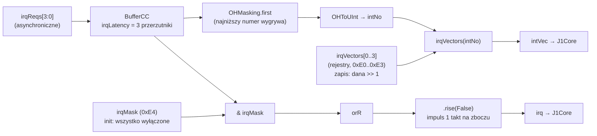
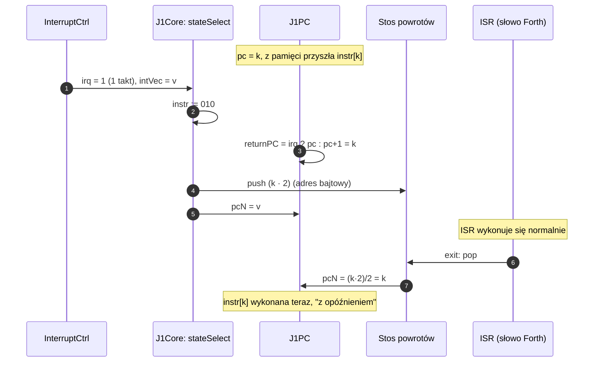
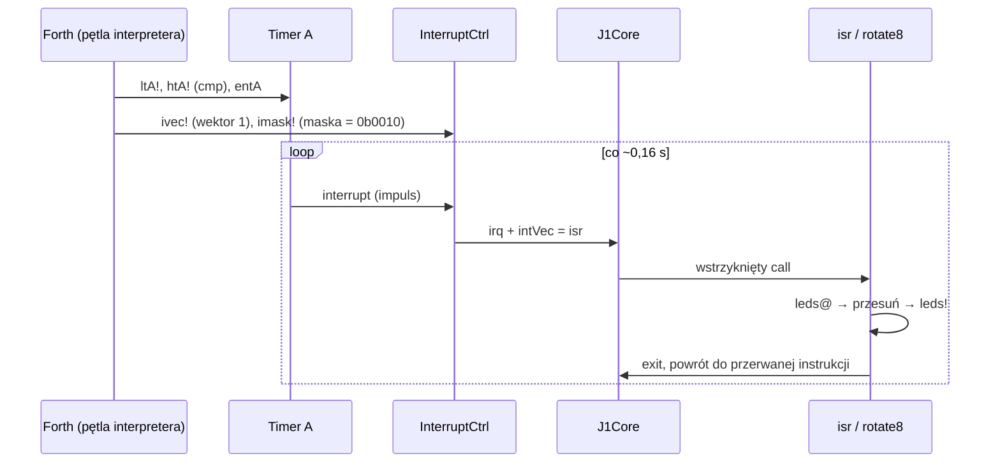

# 06 · Przerwania

[← spis treści](README.md) · źródła: [InterruptCtrl.scala](../src/main/scala/InterruptCtrl.scala), [J1Core.scala](../src/main/scala/J1Core.scala), [J1PC.scala](../src/main/scala/J1PC.scala), [irqdemo.fs](../toolchain/forth/demos/irqdemo.fs)

## 1. Idea

J1 nie ma "trybu przerwania", rejestru flag ani instrukcji `reti`. Przerwanie to po prostu **wstrzyknięcie
instrukcji `call <wektor>`** w miejsce instrukcji pobranej z pamięci. Procedura obsługi (ISR) jest zwykłym słowem
Forth zakończonym `exit`.

## 2. Źródła przerwań (Nexys4X / Ico / Ice)

| Nr | Priorytet | Źródło | Połączenie w topie |
|----|-----------|--------|--------------------|
| 0 | najwyższy | UART: jest bajt w RX FIFO | `uartBridge.interruptCtrl.readInt` |
| 1 | | Timer A | `timerA.io.interrupt` |
| 2 | | Timer B | `timerB.io.interrupt` |
| 3 | najniższy | pin zewnętrzny `extInt` | `io.extInt` |

Liczba wszystkich przerwań to `irqConfig.numOfInterrupts = 4`. Z nich `numOfInternalInterrupts = 3` jest wewnętrznych,
więc pin `extInt` ma szerokość 4 − 3 = 1.

## 3. Budowa kontrolera



Szczegóły ([InterruptCtrl.scala](../src/main/scala/InterruptCtrl.scala)):

* **Synchronizacja** (`BufferCC`): żądania mogą przychodzić z zewnątrz w dowolnej chwili, więc przechodzą przez łańcuch
  przerzutników (ochrona przed metastabilnością).
* **Wektory** są zapisywane jako `(dana >> 1)`. Program podaje adres bajtowy (np. `['] isr`), a sprzęt trzyma adres
  słowa, bo tego wymaga instrukcja `call`.
* **Maska** po resecie = 0, więc żadne przerwanie nie jest aktywne, dopóki program nie zapisze `0xE4`.
* **`irq` to impuls na zboczu narastającym** sumy (OR) zamaskowanych żądań. To ważne: jeśli jedno żądanie trwa
  (np. UART ma dane i trzyma `readInt` = 1), kolejne przerwanie nie wygeneruje nowego zbocza, dopóki suma nie
  spadnie do 0.

## 4. Co robi CPU, gdy przyjdzie `irq`



Kluczowe jest `returnPC = Mux(irq, pc, pcPlusOne)` w [J1PC.scala:24](../src/main/scala/J1PC.scala#L24). Instrukcja spod
`pc` została zastąpiona przez `call`, więc **po powrocie trzeba ją wykonać**. Dlatego adres powrotu to `pc`, a nie
`pc + 1`.

Priorytety w multiplekserze rdzenia ([J1Core.scala:55-59](../src/main/scala/J1Core.scala#L55-L59)): **stall wygrywa
z przerwaniem**. Gdy CPU jest zatrzymany przez JTAG, impuls `irq` przepada.

## 5. Programowanie z poziomu Forth

Z [peripheral.fs](../toolchain/forth/common/peripheral.fs):

```forth
: iBase  ( -- c )   $e0 ;
: ivec!  ( a c -- ) iBase + io! ;   \ adres ISR a → wektor nr c
: imask! ( c -- )   iBase 4 + io! ; \ maska
```

Demo [irqdemo.fs](../toolchain/forth/demos/irqdemo.fs), czyli "wędrująca dioda" sterowana Timerem A:

```forth
: isr rotate8 ;          \ ISR = zwykłe słowo, kończy się exit
: iDemo
    $80 leds!
    0 ltA! 250 htA!      \ okres timera A = 250 · 65536 taktów
    ['] isr 1 ivec!      \ wektor przerwania 1 (Timer A) = isr
    2 imask!             \ maska: bit 1
    entA ;               \ start timera
```



## 6. Ograniczenia, które warto znać

1. **Brak automatycznego blokowania przerwań w ISR.** Kontroler nie zeruje maski, więc zagnieżdżenie jest możliwe
   (ograniczone zboczowym wyzwalaniem).
2. **ISR musi zachować stos.** Nie ma zapisywania kontekstu. ISR, która zostawi coś na stosie danych, zepsuje
   przerwany program.
3. **Wybór wektora nie uwzględnia maski**: `intNo` liczony jest z `irqSync`, a nie z `irqSync & irqMask` (szczegóły
   w [10-obserwacje.md](10-obserwacje.md)).
4. **Przerwanie między dwiema instrukcjami `io@`**: co wtedy? Dobre ćwiczenie do symulacji. Druga instrukcja `6D50`
   wykona się dopiero po powrocie z ISR, a ISR mogła w międzyczasie użyć magistrali.
