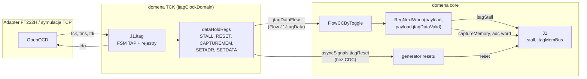
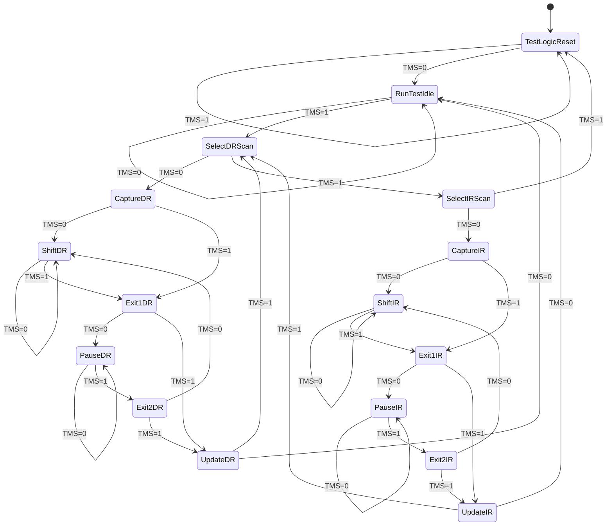
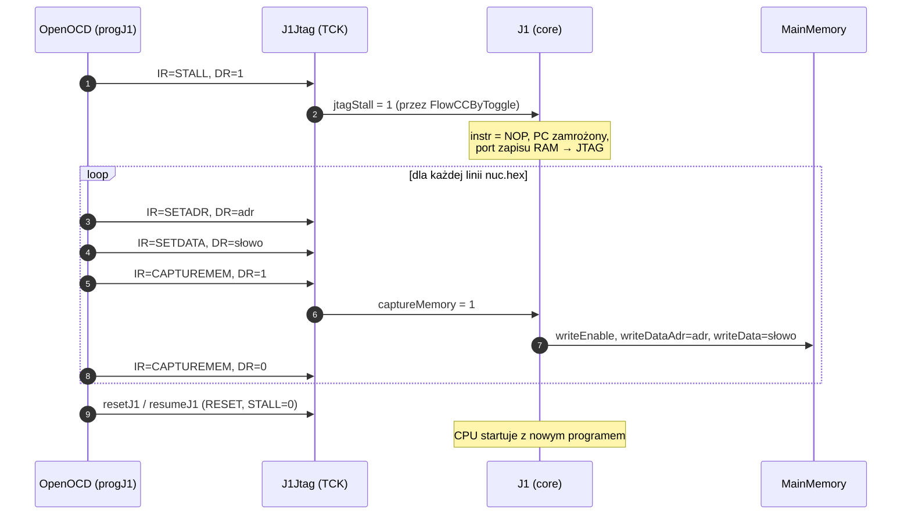

# 07 · JTAG i debugowanie

[← spis treści](README.md) · źródła: [J1Jtag.scala](../src/main/scala/J1Jtag.scala), [J1JtagData.scala](../src/main/scala/J1JtagData.scala), [SingleStepUnit.scala](../src/main/scala/SingleStepUnit.scala), [J1Nexys4X.scala:54-173](../src/main/scala/J1Nexys4X.scala#L54-L173), [support/openocd](../support/openocd)

## 1. Do czego służy JTAG w J1Sc

Uproszczony port JTAG (stan "very early stage" wg README) pozwala z komputera:

* **zatrzymać / wznowić** CPU (`STALL`),
* **zresetować** CPU (`RESET`),
* **wgrać pamięć** słowo po słowie bez ponownej syntezy (`SETADR`, `SETDATA`, `CAPTUREMEM`),
* odczytać **IDCODE** (`0x01234567`).

Nie ma odczytu rejestrów, breakpointów ani podglądu pamięci.

## 2. Architektura i domeny zegarowe



* `J1Jtag` działa w osobnej domenie zegarowej taktowanej pinem **TCK**, z resetem asynchronicznym od globalnego resetu.
* Dane do CPU tworzą **`Flow[J1JtagData]`** (`valid` + `payload`), przenoszony do domeny core przez
  **`FlowCCByToggle`**: bit przełącznika + synchronizator, bezpieczny dla wolnych, rzadkich zmian.
* Reset JTAG idzie inną drogą, bezpośrednio do `ResetCtrl.asyncAssertSyncDeassert`. To bezpieczne, bo reset
  asynchronicznie się włącza, a synchronicznie zwalnia.

### `J1JtagData`: paczka danych

[J1JtagData.scala](../src/main/scala/J1JtagData.scala): `Bundle` z `jtagDataValid`, `jtagStall`, `jtagCaptureMemory`,
`jtagCPUAdr`, `jtagCPUWord`, plus metody pomocnicze `init()` i `clear()`.

## 3. Maszyna stanów TAP

Standardowa, 16-stanowa maszyna JTAG (IEEE 1149.1), zaimplementowana przez `spinal.lib.fsm.StateMachine`
([J1Jtag.scala:167-381](../src/main/scala/J1Jtag.scala#L167-L381)). Przejścia zależą tylko od `TMS` na zboczu `TCK`.



Co robią stany w J1Sc:

| Stan | Akcja |
|------|-------|
| TestLogicReset | IR := IDCODE, `jtagDataValid` = 1 |
| RunTestIdle | `jtagDataValid` = 1, więc dane są stabilne i CPU może je przejąć |
| CaptureDR | `shift[i] := hold[i]` (tryb `r`) lub stała (tryb `c`, IDCODE) |
| ShiftDR | `shift[i] := (tdi ## shift[i]) >> 1`, wyjście `tdo = shift[i].lsb` |
| UpdateDR | `hold[i] := shift[i]` (tryb `w`) |
| CaptureIR | `irShift := ...11101` (dwa najmłodsze bity `01` wymagane przez standard) |
| ShiftIR | przesuwanie IR |
| UpdateIR | `instructionHoldReg := irShift` |

## 4. Komendy (rejestr instrukcji 5 bitów)

Zdefiniowane jako lista krotek `(nazwa, id, kod, szerokość DR, tryb, stała)` ([J1Jtag.scala:65-74](../src/main/scala/J1Jtag.scala#L65-L74)).
Rejestry danych **generowane są pętlą** z tej listy, więc dodanie komendy to dopisanie krotki.

| Komenda | Kod IR | Szerokość DR | Tryb | Funkcja |
|---------|-------:|-------------:|------|---------|
| BYPASS | 31 (`11111`) | 1 | rw | wymagane przez standard |
| STALL | 5 | 1 | rw | 1 = zatrzymaj CPU |
| RESET | 9 | 1 | rw | 1 = trzymaj CPU w resecie |
| CAPTUREMEM | 13 | 1 | rw | 1 = zapisuj `SETDATA` pod `SETADR` |
| SETADR | 17 | `adrWidth` (12) | w | adres słowa RAM |
| SETDATA | 21 | 16 | w | dane |
| IDCODE | 25 | 32 | c | stała `0x01234567` |

Kody mają postać `4·k + 1`, więc dwa najmłodsze bity zawsze wynoszą `01`.

**Efekt uboczny elaboracji:** konstruktor `J1Jtag` **zapisuje plik** `support/openocd/gen/jinfo` z kodami i
szerokościami komend ([J1Jtag.scala:81-131](../src/main/scala/J1Jtag.scala#L81-L131)). Skrypty OpenOCD go `source`-ują,
więc sprzęt i skrypty nie rozjadą się po zmianie kodów.

## 5. Wgrywanie programu przez JTAG

Skrypt [support/openocd/command/progJ1](../support/openocd/command/progJ1) czyta `toolchain/forth/build/16bit/nuc.hex`:



Skrypty w [support/openocd/bin](../support/openocd/bin): `progJ1`, `resetJ1`, `resumeJ1`, `stallJ1` (sprzęt)
i warianty `...Sim` (symulacja). Wymagają forka OpenOCD autora (`openocd_riscv`) z interfejsem `jtag_tcp`.

## 6. JTAG w symulacji

[J1BoardSim.scala](../src/test/scala/J1BoardSim.scala) otwiera **serwer TCP na porcie 7894**. Każdy bajt od OpenOCD
koduje stan pinów: bit 0 = TMS, bit 1 = TDI, bit 3 = TCK. Symulacja ustawia piny DUT i odsyła wartość TDO.
Konfiguracja OpenOCD: [support/openocd/target/sim/tcp](../support/openocd/target/sim/tcp).

## 7. `SingleStepUnit`: niewykorzystany klocek

[SingleStepUnit.scala](../src/main/scala/SingleStepUnit.scala) **nie jest nigdzie instancjonowany**. Logika:

```scala
stepMode := RegNext(enableSingleStep)
doStep   := !stepMode || triggerStep.rise(False)
```

Poza trybem krokowym `doStep` = 1 (praca ciągła). W trybie krokowym `doStep` jest impulsem na każde zbocze
`triggerStep`. Podpięcie `stall := !doStep` i dodanie komend JTAG `STEPMODE`/`STEP` dałoby pracę krokową, co jest
dobrym ćwiczeniem (Etap 8 w [README](README.md#etap-8-własne-modyfikacje-projekt-zaliczeniowy)).
