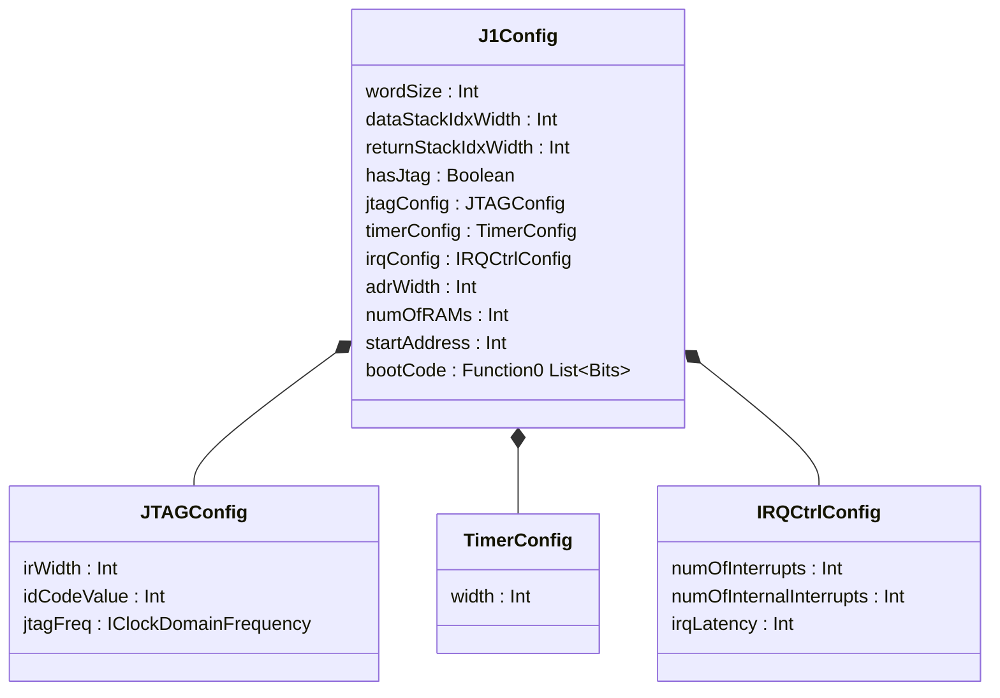
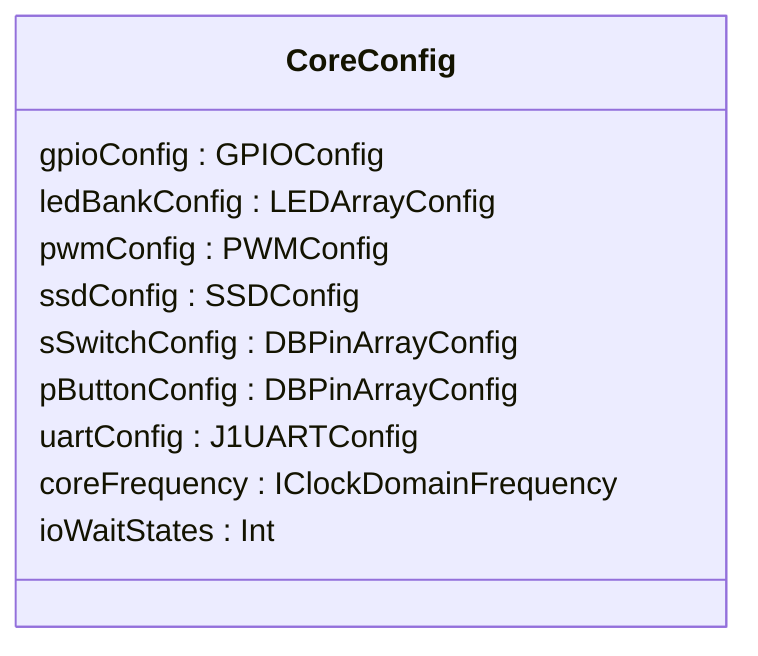
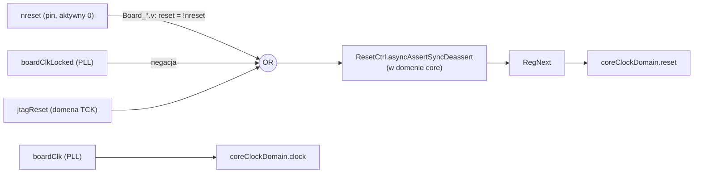
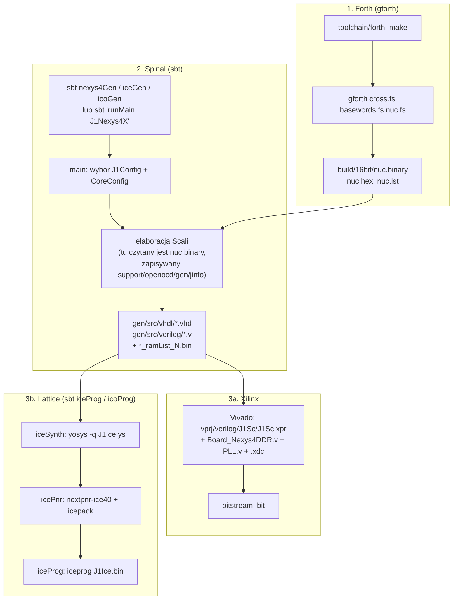
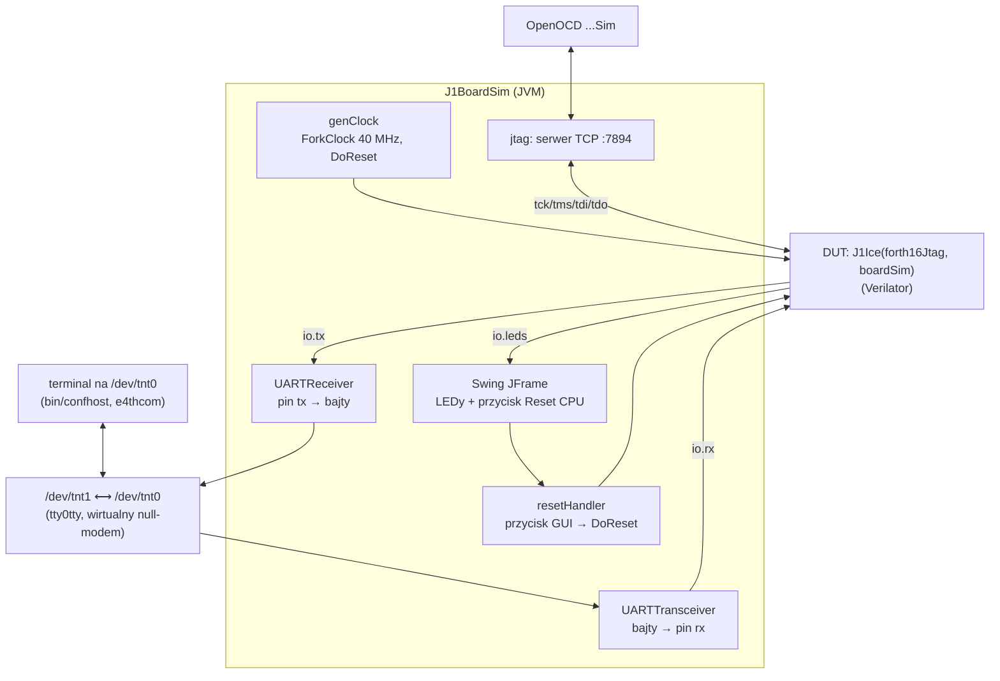

# 08 · Konfiguracja, płytki, zegar/reset, build i symulacja

[← spis treści](README.md) · źródła: [J1Config.scala](../src/main/scala/J1Config.scala), [CoreConfig.scala](../src/main/scala/CoreConfig.scala), [J1Nexys4X.scala](../src/main/scala/J1Nexys4X.scala), [J1Ico.scala](../src/main/scala/J1Ico.scala), [J1Ice.scala](../src/main/scala/J1Ice.scala), [J1BoardSim.scala](../src/test/scala/J1BoardSim.scala), [build.sbt](../build.sbt)

## 1. Konfiguracje

### 1.1 `J1Config`: parametry procesora

Gotowe presety w obiekcie `J1Config`:

| Preset | adrWidth (RAM) | dstack/rstack | JTAG | IRQ | `bootCode` | Do czego |
|--------|---------------:|:-------------:|:----:|:---:|------------|----------|
| `default16` | 13 (8K słów) | 8 / 4 | ✔ | 8 | `endless` (skok w miejscu) | ogólny |
| `debug16` | 10 | 5 / 4 | ✔ | 4 | `isaTest` + wektory `JMP60` | test ISA |
| `debugIO` | 13 | 5 / 4 | ✔ | 4 | `ioTest` | test magistrali I/O |
| `debug16IRQ` | 9 | 5 / 4 | ✔ | 4 | `simpleIRQTest` | test przerwań |
| `blank16Jtag` | 12 | 5 / 5 | ✔ | 4 | `endless` | pusty CPU, program wgrywa się przez JTAG |
| **`forth16Jtag`** | 12 (4K słów) | 5 / 5 | ✔ | 4 | **`nuc.binary`** | **SwapForth: Nexys, Ico, symulacja** |
| `forth16` | 12 | 5 / 5 | ✘ | 4 | `nuc.binary` | SwapForth bez JTAG: iCEBreaker |

* `bootCode` to **funkcja** (`() => List[Bits]`), a nie lista. Plik `nuc.binary` czytany jest więc dopiero wtedy,
  gdy `MainMemory` jej użyje. Wybranie presetu `debug16` nie wymaga zbudowanego Fortha.
* `forthBase(w)` szuka pliku w `toolchain/forth/build/16bit/nuc.binary`, względnie albo względem zmiennej
  środowiskowej **`J1SCBASE`**. Linie niebędące liczbą są pomijane (komentarze).
* Końcówka pamięci (`noOfInterrupts` słów) jest w presetach Forth obcinana i zerowana. To pozostałość po wcześniejszej
  wersji, w której wektory przerwań leżały w RAM. Teraz trzyma je `InterruptCtrl`.

### 1.2 `CoreConfig`: parametry płytki

| Preset | Zegar | UART | LED | PWM | SSD | Switche / przyciski |
|--------|------:|-----:|----:|----:|:---:|---------------------|
| `nexys4DDR` | 100 MHz | 115200 | 16 | 6 | 8 | 16 / 5 |
| `nexys4` | 100 MHz | 921600 | 16 | 6 | 8 | 16 / 5 |
| `icoBoard` | 40 MHz | 115200 | 8 | 3 | (nieużyte) | (nieużyte) |
| `iceBoard` | 18 MHz | 115200 | 4 | 1 | `null` | `null` / 2 |
| `boardSim` | 40 MHz | 38400 | 8 | 3 | (nieużyte) | (nieużyte) |

`ioWaitStates = 1` we wszystkich presetach (parametr `delayIt`, patrz [04 §4](04-pamiec-i-magistrala.md#4-timing-operacji-na-magistrali)).

## 2. Porównanie płytek

| | **J1Nexys4X** | **J1Ico** | **J1Ice** |
|-|---------------|-----------|-----------|
| FPGA | Xilinx Artix-7 | Lattice iCE40 HX8K | Lattice iCE40 UP5K |
| Konfiguracja CPU | `forth16Jtag` | `forth16Jtag` | `forth16` (bez JTAG) |
| Konfiguracja płytki | `nexys4DDR` | `icoBoard` | `iceBoard` |
| Wrapper HDL | `Board_Nexys4DDR.v/.vhd` | `Board_IcoBoard.v` | `Board_IceBreaker.v` |
| Narzędzia | Vivado (`vprj/`) | yosys + nextpnr + icoprog | yosys + nextpnr + iceprog |
| LEDArray `0x40` | ✔ 16 | ✔ 8 (PMOD) | ✔ 4 |
| PWM `0x50` | ✔ 6 (RGB) | ✔ 3 | ✔ 1 |
| SSD `0x60` | ✔ | — | — |
| GPIO `0x70` | ✔ | ✔ | ✔ |
| Switche `0x80` | ✔ | — | — |
| Przyciski `0x90` | ✔ | — | ✔ 2 |
| Timer A/B, IRQ, UART | ✔ | ✔ | ✔ |
| Dodatki | — | — | `uartLed` (aktywność UART, timeout 50 ms) |

Wszystkie trzy topy mają **identyczną strukturę**: `jtagCondIOArea` → `jtagIface` → `clkCoreCtrl` → `coreArea`.
Różnią się tylko listą peryferiów. Najlepiej czytać `J1Nexys4X`, a pozostałe porównywać diffem.

## 3. Zegar i reset

* **`ClockDomain.internal("core", frequency)`**: domena tworzona ręcznie, a jej zegar i reset podłączane są do
  sygnałów `io` ([J1Nexys4X.scala:104-137](../src/main/scala/J1Nexys4X.scala#L104-L137)). Podana częstotliwość służy
  Spinalowi do przeliczania czasów (`Timeout(1 ms)`, `newSlowedClockDomain(200 Hz)`, baudrate UART).
* **Reset**: dowolne źródło włącza go natychmiast (asynchronicznie), a wyłączenie następuje synchronicznie z
  zegarem. Dzięki temu wszystkie przerzutniki wychodzą z resetu w tym samym takcie. CPU trzymane jest w resecie,
  dopóki PLL się nie zablokuje.
* **`globalClockConfig`** (w obiekcie `main` każdego topu): `resetKind = SYNC`, `resetActiveLevel = HIGH`. Rejestry
  w domenie core mają reset synchroniczny.
* Domena JTAG ma reset **asynchroniczny** od `io.reset` (bo TCK może w ogóle nie tykać).

## 4. Proces budowania

Zadania sbt są zdefiniowane w [build.sbt](../build.sbt) i łączone zależnościami:
`iceProg` → `icePnr` → `iceSynth` → `iceGen` (tak samo dla `ico...`). Zadanie `cleanAll` usuwa wygenerowane pliki.

> **Windows:** zadania syntezy wywołują `rm`, `cp`, `yosys`, `nextpnr-ice40`. Uruchamiaj je w WSL albo Git Bash z
> zainstalowanymi narzędziami. Samo `sbt "runMain J1Nexys4X"` działa wszędzie, gdzie jest JVM. sbt 0.13.16 i
> Scala 2.11 wymagają **Javy 8**.

## 5. Symulacja (`J1BoardSim`)

[J1BoardSim.scala](../src/test/scala/J1BoardSim.scala), uruchamiana przez `sbt test:run`. Spinal kompiluje design
Verilatorem i steruje nim z wątków Scali (`fork`).

* UART jest symulowany **programowo** (bit po bicie, `sleep(baudPeriod)`), a bajty idą przez `jssc` do wirtualnego
  portu `/dev/tnt1`. Moduł jądra `tty0tty` (submoduł git) łączy go z `/dev/tnt0`, na którym pracuje terminal.
  **Działa tylko na Linuksie.**
* Co `simCycles = 10 000 000` taktów symulacja wypisuje "speedup", czyli stosunek czasu symulowanego do rzeczywistego.
* Uwaga: mimo komunikatów "IcoBoard" kompilowany jest **`J1Ice`** z konfiguracją `forth16Jtag` (czyli z JTAG) i
  `boardSim`.
