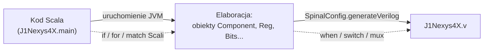

# 09 · Ściąga: SpinalHDL i Scala w tym repozytorium

[← spis treści](README.md)

Każdy przykład pochodzi z kodu J1Sc. Wersja Spinala: **1.4.2** (stara składnia, np. `in Bool` bez nawiasów).

## 1. Najważniejsza zasada

**Kod Scali uruchamia się raz, podczas generacji HDL ("elaboracji")**. Pętle `for`, `if`, `match` i funkcje Scali
*budują* układ, ale nie istnieją w nim. Sprzętowe "if" to `when` / `switch` / `mux`.



Przykład: `if (cfg.hasJtag) {...}` w [J1.scala:60](../src/main/scala/J1.scala#L60) decyduje, *czy w ogóle* powstanie
multiplekser JTAG. Natomiast `when (internal.stall) {...}` wewnątrz tworzy sam multiplekser w sprzęcie.

## 2. Struktura: `Component`, `Area`, `Bundle`

| Konstrukcja | Co to | Przykład |
|-------------|-------|----------|
| `class X extends Component` | moduł HDL z portami | `J1Core`, `MainMemory`, `LEDArray` |
| `new Area { ... }` | grupa logiki **bez** osobnego modułu (tylko przestrzeń nazw) | `jtagCondIOArea`, `J1Stack`, `driveFrom` zwraca `Area` |
| `new ClockingArea(cd) { ... }` | Area, w której rejestry używają domeny `cd` | `coreArea`, `pwmArea`, `ssdArea` |
| `new Bundle { val a = in Bool }` | grupa sygnałów (struktura) | `internal`, `bus`, `io` |
| `case class J1Bus(...) extends Bundle with IMasterSlave` | typ interfejsu z kierunkami master/slave | `J1Bus`, `J1JtagData` |
| `case class J1Alu(cfg) { def apply(...) }` | zwykła klasa Scali, która generuje logikę w module wywołującym | `J1Alu`, `J1Decoder`, `J1PC` |
| `.setName("")` | porty bundle'a bez prefiksu w HDL (`stall` zamiast `internal_stall`) | prawie każdy `Bundle` |
| `cond generate new Area {...}` | Area tworzona warunkowo, inaczej `null` | `cfg.hasJtag generate ...` |

## 3. Typy sygnałów

| Typ | Opis | Przykład |
|-----|------|----------|
| `Bool` | 1 bit | `val stall = in Bool` |
| `Bits(n bits)` | wektor bez arytmetyki | `instr`, `dtos` |
| `UInt(n bits)` / `SInt(n bits)` | liczba bez znaku / ze znakiem | `pc`, `stackPtrInc` |
| `Vec(T, n)` | tablica sygnałów | `compareRegs`, `irqVectors` |
| `B"0110_0000"`, `U(5)`, `B(0, 16 bits)` | stałe | `J1ISA16.instrNOP` |
| `M"0_1--"` | **maska** dla `switch/is`, `-` = dowolny bit | dekodery w `J1PC`, `J1Decoder` |
| `B(16 bits, default -> True)` | wypełnienie | flagi porównań w ALU |

Konwersje: `.asBits`, `.asUInt`, `.asSInt`, `.resize(n)` / `.resized`, `##` (konkatenacja), `x(7 downto 4)` (wycinek),
`.msb`, `.lsb`, `.orR` (OR wszystkich bitów), `.rise()` (wykrycie zbocza).

## 4. Przypisania i logika kombinacyjna

| Składnia | Znaczenie |
|----------|-----------|
| `a := b` | steruj `a` wartością `b` (ostatnie przypisanie wygrywa) |
| `a <> b` | połącz porty (kierunek ustalany automatycznie) |
| `when(c) {...} .otherwise {...}` | sprzętowy if |
| `switch(x) { is(M"1_---") {...} default {...} }` | sprzętowy case |
| `sel.mux(B"00" -> a, B"01" -> b, ...)` | multiplekser z tablicą | 
| `Mux(c, a, b)` / `c ? a \| b` | multiplekser 2:1 |

```scala
// J1Core.scala:55 - multiplekser trybów
val instr = stateSelect.mux(B"b00" -> internal.memInstr,
                            B"b01" -> B"b010" ## internal.intVec.resize(cfg.wordSize - 3),
                            B"b10" -> J1Config.instrNOP(cfg.wordSize),
                            B"b11" -> J1Config.instrNOP(cfg.wordSize))
```

## 5. Rejestry

| Składnia | Znaczenie | Przykład |
|----------|-----------|----------|
| `Reg(T) init(v)` | rejestr z wartością po resecie | `pc = Reg(UInt(13 bits)) init(0)` |
| `RegInit(v)` | jw. krócej | `selector` w SSD |
| `RegNext(x) init(v)` | rejestr = `x` z poprzedniego taktu | `dtos = RegNext(dtosN) init(0)` |
| `RegNextWhen(x, en, init)` | łapie `x` tylko gdy `en` | rejestry w peryferiach |
| `Delay(x, n)` | `n` rejestrów w szeregu | `Delay(extAdr, 1)` w `J1` |
| `.randBoot()` | losowa wartość startowa w symulacji (bez resetu) | rejestr IR w JTAG |
| `.allowPruning()` | nie ostrzegaj, że sygnał jest nieużywany | `internal.stall` |

## 6. Pamięci

```scala
val mem = Mem(Bits(16 bits), wordCount = 32)              // pusta
val mem = Mem(Bits(16 bits), initialContent)              // z zawartością (MainMemory)
mem.write(address = a, data = d, enable = e)              // port zapisu
val q = mem.readAsync(address = a, readUnderWrite = writeFirst)  // odczyt kombinacyjny (stosy)
val q = mem.readSync(address = a)                         // odczyt rejestrowany (BRAM, MainMemory)
```

`readAsync` syntezuje się zwykle do rozproszonej pamięci LUT, a `readSync` do bloków BRAM.

## 7. Domeny zegarowe

```scala
ClockDomain.internal(name = "core", frequency = FixedFrequency(100 MHz))   // ręcznie podłączana
ClockDomain(config = cfg, clock = tck, reset = io.reset)                   // z istniejących sygnałów
ClockDomain.current.newSlowedClockDomain(51200 Hz)                         // wolniejsza (clock enable)
ClockDomain.current.isResetActive                                          // reset jako sygnał
ResetCtrl.asyncAssertSyncDeassert(input, clockDomain)                      // synchronizator resetu
BufferCC(x, init, bufferDepth = 3)                                         // synchronizator sygnału
FlowCCByToggle(input, inputClock, outputClock)                             // przejście Flow między domenami
```

## 8. Elementy ze `spinal.lib` użyte w projekcie

| Element | Gdzie | Do czego |
|---------|-------|----------|
| `master(...)` / `IMasterSlave` | `J1Bus`, `J1JtagData` | kierunki portów interfejsu |
| `Flow[T]` | `J1Jtag.jtagDataFlow` | strumień `valid + payload` bez backpressure |
| `BusSlaveFactory(Delayed)` | `J1BusSlaveFactory`, `driveFrom` | automatyczny dekoder rejestrów |
| `Timeout(1 ms)` | `DBPinArray`, `J1Ice` | licznik czasu |
| `OHMasking.first`, `OHToUInt` | `InterruptCtrl`, `SSD` | priorytet i konwersja one-hot |
| `StateMachine`, `State`, `EntryPoint`, `goto` | `J1Jtag` | maszyny stanów |
| `UartCtrl` + `driveFrom` | topy | gotowy UART z FIFO |
| `TriStateArray` | `pmodA` | pin dwukierunkowy |

## 9. Generacja HDL

```scala
// J1Nexys4X.scala:303
SpinalConfig(mergeAsyncProcess = true,
             defaultConfigForClockDomains = globalClockConfig,
             targetDirectory = "gen/src/verilog").generateVerilog(elaborate).printPruned()
```

`printPruned()` wypisuje sygnały usunięte jako nieużywane, co pomaga przy szukaniu niepodłączonych przewodów.

## 10. Scala, której możesz nie znać

| Konstrukcja | Przykład | Znaczenie |
|-------------|----------|-----------|
| `case class` | `J1Config(...)` | klasa-rekord z `equals`, `copy`, bez `new` |
| `object X { def default = ... }` | `CoreConfig.nexys4DDR` | "statyczne" fabryki konfiguracji |
| `def apply(...)` | `dStack(stall, dtosN)` | obiekt wywoływany jak funkcja |
| krotki `(a, b, c)` i `._1` | `pcInfo._1` | wiele wartości zwrotnych |
| `for (x <- xs) yield {...}` | `ramList`, `dataHoldRegs` | generowanie listy (tu: wielu kawałków sprzętu) |
| `(a, b).zipped.foreach(_ := _)` | PWM, InterruptCtrl | przypisanie parami |
| `() => List[Bits]` | `bootCode` | funkcja bez argumentów (leniwe wyliczenie) |
| `100 MHz`, `5 ms` | konfiguracje | jednostki fizyczne Spinala (`HertzNumber`, `TimeNumber`) |
