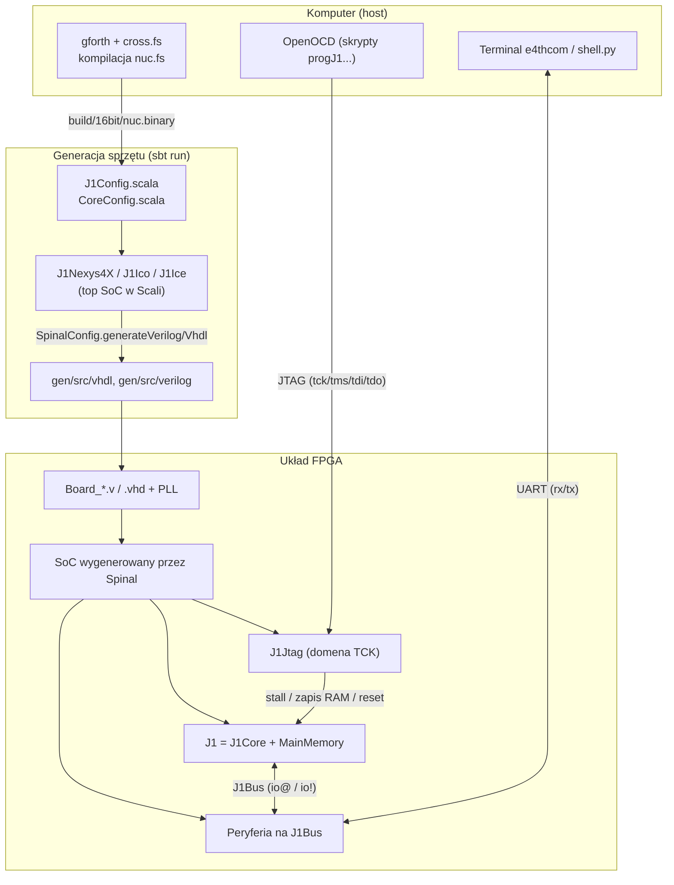
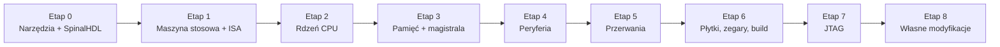
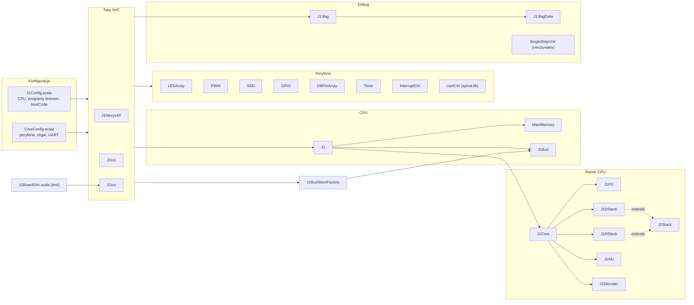

# J1Sc: przewodnik do nauki

> Dokumentacja wygenerowana na podstawie kodu źródłowego (Scala / SpinalHDL, Forth, Verilog).
> Wszystkie diagramy są w Mermaid, więc renderują się na GitHubie i w VS Code (z rozszerzeniem *Markdown Preview Mermaid Support*).

## Czym jest ten projekt?

**J1Sc** to reimplementacja procesora stosowego **J1** (James Bowman, excamera) w języku **SpinalHDL**, czyli DSL-u
w Scali, który *generuje* VHDL/Verilog. Wokół procesora zbudowano kompletny **SoC** (System-on-Chip):

* 16-bitowy CPU z dwoma stosami sprzętowymi (danych i powrotów), wykonujący jedną instrukcję na takt,
* pamięć główną w blokach BRAM, wypełnioną przy syntezie obrazem systemu **SwapForth**,
* magistralę peryferiów z diodami, PWM (RGB), wyświetlaczem 7-seg, GPIO, przełącznikami, timerami, UART-em i kontrolerem przerwań,
* uproszczony interfejs **JTAG** do zatrzymywania CPU i wgrywania pamięci,
* gotowe "topy" dla płytek Nexys4/Nexys4DDR (Xilinx), IcoBoard i iCEBreaker (Lattice) oraz symulację w Verilatorze.

Na tym sprzęcie działa interpreter Forth, z którym rozmawiasz przez UART.

## Mapa dokumentów

| # | Plik | O czym | Pliki źródłowe |
|---|------|--------|----------------|
| 01 | [01-architektura.md](01-architektura.md) | Widok z lotu ptaka: hierarchia, zależności plików, przepływ danych, domeny zegarowe | wszystkie |
| 02 | [02-isa.md](02-isa.md) | Lista rozkazów J1, kodowanie bitów, jak słowa Forth mapują się na instrukcje | `J1Config.scala` (J1ISA16), `toolchain/forth/basewords.fs` |
| 03 | [03-rdzen-cpu.md](03-rdzen-cpu.md) | Wnętrze CPU: PC, stosy, ALU, dekoder, ścieżka danych, śledzenie cykl po cyklu | `J1Core`, `J1PC`, `J1Stack`, `J1DStack`, `J1RStack`, `J1Alu`, `J1Decoder` |
| 04 | [04-pamiec-i-magistrala.md](04-pamiec-i-magistrala.md) | Pamięć główna, magistrala J1Bus, fabryka slave'ów, timing `io@`/`io!`/`@`/`!` | `J1`, `MainMemory`, `J1Bus`, `J1BusSlaveFactory` |
| 05 | [05-peryferia.md](05-peryferia.md) | Mapa adresów I/O i działanie każdego peryferium | `LEDArray`, `PWM`, `SSD`, `GPIO`, `DBPinArray`, `Timer`, UART |
| 06 | [06-przerwania.md](06-przerwania.md) | Kontroler przerwań i to, jak CPU "wstrzykuje" wywołanie ISR | `InterruptCtrl`, `J1Core`, `J1PC` |
| 07 | [07-jtag-i-debug.md](07-jtag-i-debug.md) | Maszyna stanów TAP, komendy JTAG, przejście między domenami zegarowymi, OpenOCD | `J1Jtag`, `J1JtagData`, `SingleStepUnit` |
| 08 | [08-konfiguracja-plyty-build.md](08-konfiguracja-plyty-build.md) | Konfiguracje, porównanie płytek, zegar/reset, proces budowania, symulacja | `J1Config`, `CoreConfig`, `J1Nexys4X`, `J1Ico`, `J1Ice`, `J1BoardSim`, `build.sbt` |
| 09 | [09-spinalhdl-sciaga.md](09-spinalhdl-sciaga.md) | Ściąga z konstrukcji SpinalHDL/Scali użytych w tym repo | — |
| 10 | [10-obserwacje.md](10-obserwacje.md) | Rzeczy podejrzane, nieużywane albo nieoczywiste, które wyszły przy lekturze | — |

## Jak to wszystko się łączy (diagram główny)

---

## Plan nauki krok po kroku

Plan jest ułożony **od środka na zewnątrz**: najpierw model mentalny maszyny stosowej, potem rdzeń, pamięć,
peryferia, a na końcu płytki, zegary i narzędzia. Każdy etap ma cel, listę lektur, ćwiczenie i
kryterium "wiem, że rozumiem".

### Etap 0: narzędzia i podstawy SpinalHDL (1–2 wieczory)

**Cel:** czytać kod Spinala bez zgadywania, co oznacza `:=`, `RegNext`, `Area` czy `M"0_1--"`.

* Przeczytaj [09-spinalhdl-sciaga.md](09-spinalhdl-sciaga.md).
* Wersje z repo: Scala **2.11.8**, SpinalHDL **1.4.2**, sbt **0.13.16** ([build.sbt](../build.sbt), [project/build.properties](../project/build.properties)), Java 8.
* Na Windowsie zadania `iceSynth`/`icoProg`/`cleanAll` z `build.sbt` wywołują `rm`, `cp`, `yosys`, `nextpnr`, więc **wygodniej pracować w WSL**. Samo generowanie HDL (`sbt "runMain J1Nexys4X"`) wymaga tylko JVM.
* Oficjalna dokumentacja: <https://spinalhdl.github.io/SpinalDoc-RTD/>

**Ćwiczenie:** przeczytaj [LEDArray.scala](../src/main/scala/LEDArray.scala) (67 linii). To najprostszy kompletny komponent. Wypisz na kartce porty `bus` i `io` oraz rejestry.

**Wiesz, że rozumiesz, gdy** potrafisz wyjaśnić różnicę między `Component` a `Area` i między `Reg` a `RegNext`.

### Etap 1: maszyna stosowa i ISA (1 wieczór)

**Cel:** zrozumieć, *co* procesor ma robić, zanim zobaczysz, *jak* to robi.

* [02-isa.md](02-isa.md): 5 typów instrukcji i pola instrukcji ALU.
* [toolchain/forth/basewords.fs](../toolchain/forth/basewords.fs): tu zobaczysz, że `dup`, `drop`, `+` czy `exit` to **pojedyncze instrukcje** sprzętowe.
* Przykładowe programy w asemblerze binarnym: `J1ISA16.isaTest()` w [J1Config.scala:96](../src/main/scala/J1Config.scala#L96).

**Ćwiczenie:** zdekoduj ręcznie instrukcje 0–8 z `isaTest` i wypisz stan stosu po każdej.

**Wiesz, że rozumiesz, gdy** umiesz z głowy zakodować `swap` (`0x6110`) i `r>` (`0x6B1D`).

### Etap 2: rdzeń CPU (2–3 wieczory, najważniejszy etap)

**Cel:** zobaczyć, jak jeden takt zegara wykonuje całą instrukcję.

Czytaj **w tej kolejności** (od najprostszego):

1. [J1Stack.scala](../src/main/scala/J1Stack.scala): wspólna baza stosów (20 linii)
2. [J1DStack.scala](../src/main/scala/J1DStack.scala): stos danych (rejestr T + pamięć dla N i głębiej)
3. [J1RStack.scala](../src/main/scala/J1RStack.scala): stos powrotów
4. [J1PC.scala](../src/main/scala/J1PC.scala): licznik programu i logika skoków
5. [J1Alu.scala](../src/main/scala/J1Alu.scala): ALU (jeden wielki multiplekser)
6. [J1Decoder.scala](../src/main/scala/J1Decoder.scala): wybór nowej wartości T
7. [J1Core.scala](../src/main/scala/J1Core.scala): **sklejenie wszystkiego**

Lektura: [03-rdzen-cpu.md](03-rdzen-cpu.md).

**Ćwiczenie:** przejdź tabelę śledzenia cykl po cyklu z dokumentu 03 i dopisz 3 kolejne cykle (`isaTest` instrukcje 6–8).

**Wiesz, że rozumiesz, gdy** potrafisz wyjaśnić, dlaczego pamięć instrukcji jest adresowana przez `pcN` (następny PC), a nie `pc`.

### Etap 3: pamięć i magistrala (1–2 wieczory)

**Cel:** zrozumieć, jak CPU czyta i pisze RAM oraz jak rozmawia z peryferiami.

* [J1.scala](../src/main/scala/J1.scala), [MainMemory.scala](../src/main/scala/MainMemory.scala), [J1Bus.scala](../src/main/scala/J1Bus.scala), [J1BusSlaveFactory.scala](../src/main/scala/J1BusSlaveFactory.scala)
* Lektura: [04-pamiec-i-magistrala.md](04-pamiec-i-magistrala.md). Kluczowe są diagramy czasowe `io@` (dwie instrukcje!) i sztuczka "high call", którą realizuje się `@`.

**Ćwiczenie:** w [toolchain/forth/nuc.fs](../toolchain/forth/nuc.fs) znajdź definicję `@` (`h# 2000 or execute`) i wyjaśnij, dlaczego działa.

### Etap 4: peryferia (2 wieczory)

**Cel:** poznać wzorzec `driveFrom(busCtrl, baseAddress)` i mapę adresów.

* Kolejność: `LEDArray` → `DBPinArray` → `GPIO` → `Timer` → `PWM` → `SSD` → UART z `spinal.lib`
* Lektura: [05-peryferia.md](05-peryferia.md)
* Porównaj z [toolchain/forth/common/peripheral.fs](../toolchain/forth/common/peripheral.fs), gdzie siedzą słowa Forth używające tych adresów.

**Ćwiczenie:** policz częstotliwość taktowania licznika PWM i multipleksowania SSD dla Nexys4DDR (100 MHz).

### Etap 5: przerwania (1 wieczór)

* [InterruptCtrl.scala](../src/main/scala/InterruptCtrl.scala) + fragment `stateSelect` w `J1Core`
* Lektura: [06-przerwania.md](06-przerwania.md) oraz demo [toolchain/forth/demos/irqdemo.fs](../toolchain/forth/demos/irqdemo.fs)

**Wiesz, że rozumiesz, gdy** potrafisz wyjaśnić, czemu przy przerwaniu adres powrotu to `pc`, a nie `pc + 1`.

### Etap 6: płytki, zegary, konfiguracja, build (1–2 wieczory)

* [J1Nexys4X.scala](../src/main/scala/J1Nexys4X.scala) (najpełniejszy top), potem różnice w `J1Ico` i `J1Ice`
* [J1Config.scala](../src/main/scala/J1Config.scala), [CoreConfig.scala](../src/main/scala/CoreConfig.scala)
* [src/main/verilog/arch/Nexys4DDR/Board_Nexys4DDR.v](../src/main/verilog/arch/Nexys4DDR/Board_Nexys4DDR.v): ręczny wrapper z PLL i tri-state
* Lektura: [08-konfiguracja-plyty-build.md](08-konfiguracja-plyty-build.md)

**Ćwiczenie:** uruchom `sbt "runMain J1Nexys4X"` i otwórz `gen/src/verilog/J1Nexys4X.v`. Znajdź w nim rejestr `pc` i pamięć stosu danych. (Wymaga wcześniejszego `make` w `toolchain/forth`, bo konfiguracja `forth16Jtag` czyta `nuc.binary`. Możesz też tymczasowo przełączyć `J1Nexys4X.main` na `J1Config.blank16Jtag`, która nie potrzebuje pliku).

### Etap 7: JTAG (1 wieczór, opcjonalnie)

* [J1Jtag.scala](../src/main/scala/J1Jtag.scala), [J1JtagData.scala](../src/main/scala/J1JtagData.scala), skrypty w [support/openocd](../support/openocd)
* Lektura: [07-jtag-i-debug.md](07-jtag-i-debug.md)

### Etap 8: własne modyfikacje (projekt zaliczeniowy)

Propozycje rosnącej trudności:

1. **Nowe peryferium**: licznik cykli zegara pod adresem `0xA0` (tylko odczyt, 16 bitów). Wzoruj się na `DBPinArray.driveFrom`. Dopisz słowo Forth `cycles@`.
2. **Druga instancja GPIO** (`pmodB` pod `0x78`) w `J1Nexys4X` + pin w `Board_Nexys4DDR.v`.
3. **Nowa operacja ALU**: masz wolne kody funkcji `110`/`111` w bitach 6..4. Dodaj np. "zamień bajty T".
4. **Napraw jedną z obserwacji** z [10-obserwacje.md](10-obserwacje.md) (np. szerokość wskaźnika stosu powrotów).
5. **Podłącz `SingleStepUnit`** (istnieje, ale nie jest używany) do sygnału `stall` przez nową komendę JTAG.

---

## Szybka mapa plików

| Plik | Linie | Trudność | Rola |
|------|------:|:--------:|------|
| `J1Stack.scala` | 20 | ★ | baza stosu (wskaźnik + enable) |
| `SingleStepUnit.scala` | 32 | ★ | wyzwalacz pracy krokowej (nieużywany) |
| `J1Alu.scala` | 55 | ★★ | ALU |
| `J1Decoder.scala` | 57 | ★★ | wybór następnego T |
| `J1RStack.scala` | 57 | ★★ | stos powrotów |
| `DBPinArray.scala` | 59 | ★ | debouncing wejść |
| `J1JtagData.scala` | 64 | ★ | paczka danych JTAG → CPU |
| `J1DStack.scala` | 67 | ★★ | stos danych |
| `LEDArray.scala` | 67 | ★ | diody |
| `J1Bus.scala` | 74 | ★★ | definicja magistrali |
| `J1PC.scala` | 76 | ★★★ | PC i skoki |
| `MainMemory.scala` | 84 | ★★ | RAM z banków BRAM |
| `GPIO.scala` | 85 | ★★ | port PMOD z kierunkiem |
| `PWM.scala` | 87 | ★★ | PWM (diody RGB) |
| `J1BusSlaveFactory.scala` | 97 | ★★★ | dekoder adresów magistrali |
| `J1.scala` | 107 | ★★ | CPU + RAM + magistrala |
| `InterruptCtrl.scala` | 110 | ★★★ | przerwania |
| `J1Core.scala` | 114 | ★★★ | serce procesora |
| `Timer.scala` | 117 | ★★ | timer 32-bit |
| `SSD.scala` | 154 | ★★ | wyświetlacz 7-segmentowy |
| `J1Ico.scala` | 277 | ★★ | top IcoBoard |
| `J1Ice.scala` | 308 | ★★ | top iCEBreaker (+ używany w symulacji) |
| `J1Nexys4X.scala` | 315 | ★★ | top Nexys4/Nexys4DDR |
| `J1Jtag.scala` | 406 | ★★★ | TAP JTAG |
| `CoreConfig.scala` | 456 | ★ | konfiguracje peryferiów |
| `J1BoardSim.scala` | 473 | ★★ | symulacja Verilator + GUI |
| `J1Config.scala` | 688 | ★ | konfiguracje CPU, programy testowe |
